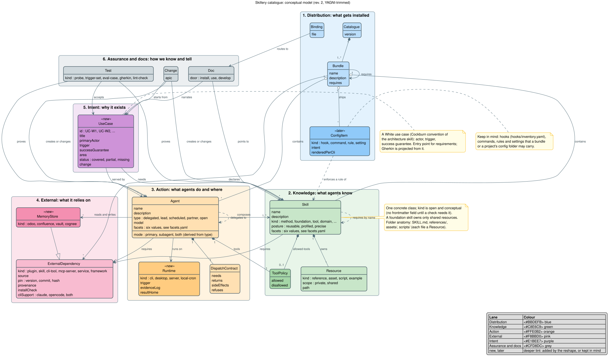

# Catalogue architecture

What the catalogue is made of, where each part lives, and where it is going. The model is the
owner's revision 2 (2026-10-27) from the
[`restructure-and-evaluate-catalogue`](../openspec/changes/archive/2026-10-26-restructure-and-evaluate-catalogue/proposal.md)
EPIC. The live gap map is [`use-cases.md`](use-cases.md); this page explains the parts behind it.

## The model

The class view's source is [`catalogue-architecture.class.puml`](catalogue-architecture.class.puml)
(PlantUML; GitHub does not render it, so a rendered SVG is committed beside it by hand whenever the
source changes). It has six lanes: **distribution** (what gets installed), **knowledge** (what agents
know), **action** (what agents do and where), **external** (what it relies on), **intent** (why it
exists) and **assurance and docs** (how we know and tell).

The model has no machine-readable source. The files below are the truth; the picture names them.

### Where each class lives

| Lane | Class | Held by | Checked by |
|---|---|---|---|
| distribution | **Catalogue** | [`VERSION`](../VERSION), rendered into `.claude-plugin/marketplace.json` and `tools/opencode-catalogue.json` | `bundle_gates` (version sync) |
| distribution | **Bundle** | [`bundles.yaml`](../bundles.yaml), rendered by `make bundles` | `bundle_gates`, `bundle_requirements`, `expected_bundle_membership` |
| distribution | **Binding** | [`AGENTS.md`](../AGENTS.md), [`CLAUDE.md`](../CLAUDE.md), [`prompts/`](../prompts/README.md) | `agents_canonical_invariant` |
| distribution | **ConfigItem** | hooks only: [`hooks/inventory.yaml`](../hooks/inventory.yaml); commands, rules and settings are planned (change `add-config-items`, later) | `hooks_inventory_shape` |
| knowledge | **Skill** | `skills/<name>/SKILL.md`, its six facets from [`facets.yaml`](../facets.yaml); `kind` stays conceptual | `frontmatter_*`, `facets_declared`, `boundary_section_present` |
| knowledge | **Resource** | every other file in a skill folder (`references/`, `assets/`, `scripts/`); shared ones sit in a foundation skill such as `meaningfy-voice` | `cross_skill_paths` |
| knowledge | **ToolPolicy** | an agent's `tools` / `disallowedTools`; a skill's optional `allowed-tools` (none declared today) | `agent_conformance`, `frontmatter_keys` |
| action | **Agent** | `agents/<name>.md`, written to [`spec/agent-template.md`](../spec/agent-template.md); `mode` derived from `type` in `tools/opencode-agent-map.json` | `agent_conformance`, `agent_bundle_membership` |
| action | **DispatchContract** | the dispatch section of each agent body | `agent_conformance` |
| action | **Runtime** | planned (change `extend-agent-template`) | — |
| external | **ExternalDependency** | prose tables in [`compatibility.md`](environment/dual-cli/compatibility.md) and [`mcp-setup.md`](environment/dual-cli/mcp-setup.md); a structured register is planned (change `add-external-dependency-register`) | — |
| external | **MemoryStore** | planned (change `add-odoo-memory-skill` for Odoo; the others with the agent that needs them) | — |
| intent | **UseCase** | [`use-cases/`](../use-cases/), one White use case per file; the view [`use-cases.md`](use-cases.md) | `use_case_catalogue`, the drift test of `make skill-inventory` |
| assurance | **Test** | probes [`tests/trigger_probes.yaml`](../tests/trigger_probes.yaml), trigger sets and eval cases in [`evals/`](../evals/README.md), agent Gherkin in `tests/features/agents/`, lint checks in `tools/repo_lint/` | `make validate` |
| assurance | **Doc** | the register in [§8 of the method](development-method.md#8-where-things-live); `door` lands with the README's three doors | `doc_register_complete`, `broken_links` |
| assurance | **Change** | an EPIC in [`openspec/changes/`](../openspec/changes/) | `make validate-spine` |

## Areas and the `ai-*` domains

The `area` facet says which part of Meaningfy's work a skill, agent or use case serves.
[`define-ai-domains`](../openspec/changes/define-ai-domains/proposal.md) organises the human docs into
three domains. The two lists meet like this:

| `area` | `ai-*` domain |
|---|---|
| `coding` | `ai-coding` (building) |
| `sales` | `ai-sales` (selling) |
| `consulting` | `ai-consulting` (advising) |
| `operations` | none yet; the nearest is `ai-coding` (delivery and operations) |
| `business`, `legal`, `design`, `personal` | none; they serve the company and the owner, not a client process |
| `cross-cutting` | every domain |

A domain is a client-facing process with its lifecycle, runbook and playbooks; an area is a tag. An
area without a domain needs no domain doc until it has a process to describe.

## Target structure

*Approved by the owner, 2026-10-26.* Bundles by activity, existing and planned. The
re-bundling itself is the change `rebundle-by-activity`; moving a skill between bundles happens there,
not here.

| Bundle | Areas | Skills | Agents | Requires |
|---|---|---|---|---|
| `meaningfy-core` | cross-cutting | `technical-writing`, `explanatory-writing`, `writing-antipatterns`, `meaningfy-voice`, `meaningfy-git-workflow`, `guardrails` | — | — |
| `meaningfy-building` | coding | the nine build skills | `epic-planner`, `implementer`, `code-reviewer` | `meaningfy-architecture` |
| `meaningfy-architecture` | coding | `architecture`, `conceptual-modelling`, `modelling-conventions`, `linkml-engineering` | planned: `system-architect`, `conceptual-modeller` | — |
| `meaningfy-consulting` | consulting | `semantic-consulting-coach`, `decision-package`, `proposal-writing`, `estimation`, `executive-communication` | — | — |
| `meaningfy-sales` *(planned)* | sales | the sales package's skills; the commercial chain | planned: `sales-assistant`, `qualifier`, `offer-designer`, `proposal-writer`, `demo-builder` | `meaningfy-consulting` |
| `meaningfy-devops` *(planned)* | operations | the devops package's skills | planned: `devops-engineer` | `meaningfy-building` |
| `vault-assistant` | personal | the nine vault skills | planned: `planner`, `secretary`, `life-coach`, `companion` | — |
| `meaningfy-business` *(planned)* | business, legal | negotiation, internal communication, contracts | planned: `business-coach`, `negotiation-partner`, `internal-comms`, `contract-drafter` | `meaningfy-consulting` |
| `meaningfy-design` *(planned)* | design | visual identity, diagram and slide styles | planned: `graphic-designer` | — |

## Agent roster

*Approved by the owner, 2026-10-26.* One row per agent. `type` is the agent
template's; `partner` is the open fourth type (Q-2), settled by `extend-agent-template`.

| Agent | Type | Use cases | Bundle | Change |
|---|---|---|---|---|
| `epic-planner` | delegated | UC-W18 | `meaningfy-building` | exists |
| `implementer` | delegated | UC-W18 | `meaningfy-building` | exists |
| `code-reviewer` | delegated | UC-W18 | `meaningfy-building` | exists |
| `system-architect` | partner | UC-W19 | `meaningfy-architecture` | `add-engineering-agents` |
| `conceptual-modeller` | partner | UC-W20 | `meaningfy-architecture` | `add-engineering-agents` |
| `sales-assistant` | scheduled | UC-W7 | `meaningfy-sales` | `add-sales-bundle` |
| `devops-engineer` | delegated | UC-W6 | `meaningfy-devops` | `add-devops-bundle` |
| `proposal-writer` | delegated | UC-W8 | `meaningfy-sales` | `add-commercial-chain` |
| `qualifier` | partner | UC-W9, UC-W10 (one method, three variants) | `meaningfy-sales` | `add-commercial-chain` |
| `market-researcher` | delegated | UC-W11 | `meaningfy-sales` | `add-commercial-chain` |
| `offer-designer` | delegated | UC-W12 | `meaningfy-sales` | `add-commercial-chain` |
| `negotiation-partner` | partner | UC-W13 | `meaningfy-business` | `add-commercial-chain` |
| `planner` | delegated | UC-W4 | `vault-assistant` | `add-personal-assistants` |
| `secretary` | scheduled | UC-W3 | `vault-assistant` | `add-personal-assistants` |
| `life-coach` | partner | UC-W2 | `vault-assistant` | `add-personal-assistants` |
| `companion` | open | UC-W5 | `vault-assistant` | `add-personal-assistants` |
| `graphic-designer` | delegated | UC-W17 | `meaningfy-design` | `add-visual-design` |
| `business-coach` | partner | UC-W14 | `meaningfy-business` | `add-business-partners` |
| `internal-comms` | scheduled | UC-W15 | `meaningfy-business` | `add-business-partners` |
| `contract-drafter` | delegated | UC-W16 | `meaningfy-business` | `add-legal-documents` |
| `demo-builder` | delegated | UC-W21 | `meaningfy-sales` | `add-demo-builder` |

## Roadmap

*Approved by the owner, 2026-10-26; `rebundle-by-activity` moved first and the evaluation split
out the same day.* Follow-on changes in waves, from this month's priorities. Each use case's `change` names one of them, so [`use-cases.md`](use-cases.md) shows what
each change closes.

| Wave | Change | Closes | Kind |
|---|---|---|---|
| 0 | `restructure-and-evaluate-catalogue` | this page, the use-case catalogue, `meaningfy-voice` | infrastructure |
| 1 | `rebundle-by-activity` | the target structure above, every use case catalogued, the agents that today's skills can serve, and the feature roadmap for the rest | infrastructure |
| 1 | `evaluate-catalogue` | behavioural evidence for every skill and agent, after the re-bundling (parked) | assurance |
| 1 | `add-sales-bundle` | UC-W7 | use cases |
| 1 | `add-engineering-agents` | UC-W19, UC-W20 | use cases |
| 1 | `extend-agent-template` | the agent aspects (runtime, memory, dependencies, tool policy) and the `partner` type (Q-2) | infrastructure |
| 1 | `add-external-dependency-register` | one structured entry per external dependency, the source of `compatibility.md` and `mcp-setup.md` | infrastructure |
| 2 | `add-devops-bundle` | UC-W6 | use cases |
| 2 | `add-commercial-chain` | UC-W8 to UC-W13 | use cases |
| 2 | `add-odoo-memory-skill` | how to store and find things in Odoo | infrastructure |
| 3 | `add-personal-assistants` | UC-W2 to UC-W5 | use cases |
| 3 | `add-vault-local-config` | UC-W1 (colleagues' local variations, DEC-13) | use cases |
| 4 | `add-visual-design` | UC-W17 | use cases |
| 4 | `add-business-partners` | UC-W14, UC-W15 | use cases |
| 4 | `add-legal-documents` | UC-W16 | use cases |
| 4 | `add-demo-builder` | UC-W21 | use cases |
| later | `add-config-items` | rules and settings a bundle or project may ship | infrastructure |
