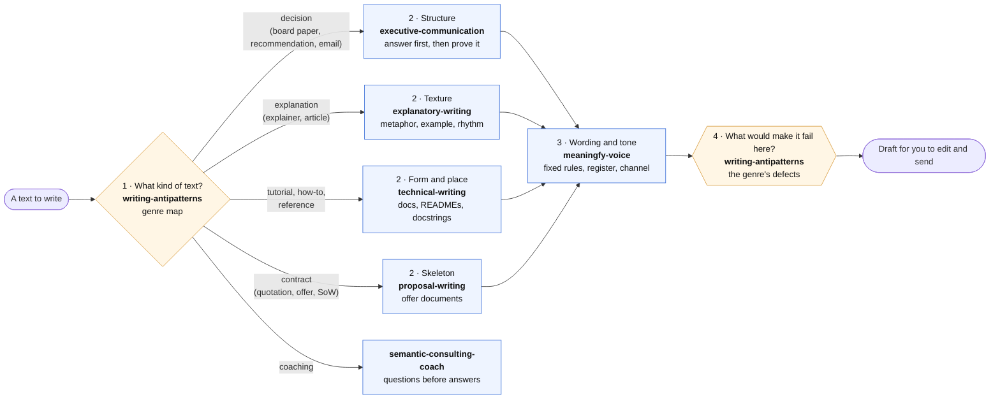
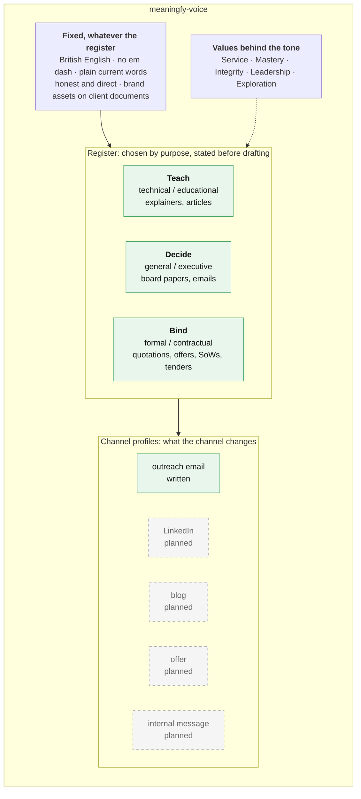
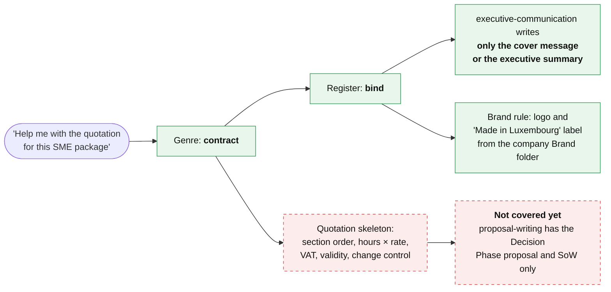
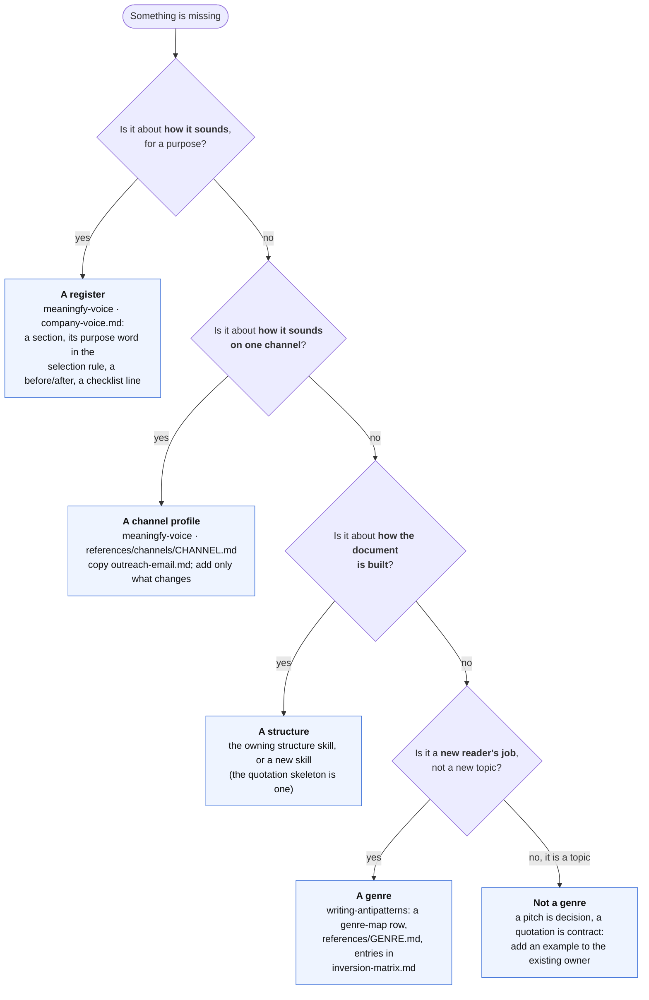

# Voice and communication skills

**Audience:** a Meaningfy colleague who writes with an agent (emails, offers, board papers,
explainers, posts) and wants to know what the skills already cover, what they do not, and how to
add what is missing.

This page explains and points. The rules themselves live in the skills it links to; when the two
disagree, the skill wins.

## The idea in one picture

No single skill writes a text. Each owns one question about it, and the agent asks them in order:
what kind of text is this, how is it built, how does it sound, and what would make it fail.

Two rules hold the picture together:

- **Voice never changes structure.** `meaningfy-voice` decides the words and the tone. The order of
  sections, the answer-first opening and the document skeleton belong to the structure skills.
- **The same move can be craft in one genre and a defect in another.** A rhetorical question
  lifts an explainer and weakens a contract. That is why the genre is named first and checked last.

| Skill | Owns | Bundle |
|---|---|---|
| [`writing-antipatterns`](../../skills/writing-antipatterns/SKILL.md) | the eight genres, the defects that apply everywhere, and the moves whose verdict depends on the genre | `meaningfy-core` |
| [`meaningfy-voice`](../../skills/meaningfy-voice/SKILL.md) | the company voice profile: fixed rules, values, registers, channel profiles | `meaningfy-core` |
| [`explanatory-writing`](../../skills/explanatory-writing/SKILL.md) | the craft that makes an explanation read clearly | `meaningfy-core` |
| [`technical-writing`](../../skills/technical-writing/SKILL.md) | documentation form and where a doc goes | `meaningfy-core` |
| [`executive-communication`](../../skills/executive-communication/SKILL.md) | message structure for decisions: governing thought, SCQA, the pyramid | `meaningfy-consulting` |
| [`proposal-writing`](../../skills/proposal-writing/SKILL.md) | the proposal and SoW skeleton, with the scope boundary | `meaningfy-sales` |

Install `meaningfy-core` for the voice and the craft; add `meaningfy-consulting` for decisions and
`meaningfy-sales` for offers.

## Inside the voice

The voice is one profile, [`company-voice.md`](../../skills/meaningfy-voice/references/company-voice.md),
plus a profile per channel that adds only what that channel changes.

**Choosing the register** is one question: are you trying to *teach* something, to *get a
decision*, or to *bind* the company to what it will deliver? The bind register is the formal one:
full sentences, defined terms, "Meaningfy will provide", no contractions, asides or persuasion.
Plain words, formal tone: plain vocabulary is not casual.

## A worked example: a formal quotation

This is the case Thomas raised in October 2026: a quotation came out chatty and pitch-shaped, and
the brand assets were missed. Here is what happens now.

So today the agent gets the **tone** of a quotation right and keeps to the cover message, but you
still bring the **quotation's own structure** from an accepted example.

## What is covered, and what is not

| Need | Status | Where, or what is planned |
|---|---|---|
| A formal and contractual register | covered | the bind register in `company-voice.md` |
| Picking the register before writing | covered | `executive-communication` states teach, decide or bind first |
| Brand assets (logo, "Made in Luxembourg") on client documents | covered | a fixed rule in `company-voice.md`, pointing to `meaningfy_brand_assets.md` in the company Brand folder |
| Examples beyond semantic consulting (SME digitalisation, AI assistants) | covered | the before/after pairs in `company-voice.md` |
| The structure of a board paper or recommendation | covered | `executive-communication` |
| The proposal and SoW of the Proof of Value | covered | `proposal-writing` |
| Outreach, follow-up and revival emails | covered | the outreach-email channel profile; what to send and when is `sales-conversations` |
| **The quotation skeleton** (section order, exclusions wording, hours table with rate, VAT and total, validity, payment, change control) | **not covered** | a planned offer skill; it needs an accepted quotation as its source (`add-commercial-chain` in [`future-features.md`](../future-features.md)) |
| **LinkedIn, blog, offer and internal-message voice** | **not covered** | placeholder profiles that fall back to the default voice (`add-content-creation`) |
| **A persuasive marketing register** (website, pitch) | **not covered** | today a pitch uses the decide register |
| **A team's internal working plan** | **not covered** | named as a gap in `writing-antipatterns` |

## Guardrails: what keeps the output on track

| Guardrail | What it does | Runs |
|---|---|---|
| Register stated first | `executive-communication` names teach, decide or bind before drafting | every use |
| Genre check | the draft is checked against its genre's defects in `writing-antipatterns`; the bind register is checked as a contract | every use |
| Voice checklist | the quick checklist at the end of `company-voice.md` (British English, no em dash, register, honesty) | every use |
| A durable spec | [`openspec/specs/executive-communication`](../../openspec/specs/executive-communication/spec.md) states the register rule with its scenarios ("a quotation is requested") | read when the skill changes |
| Trigger probes | [`tests/trigger_probes.yaml`](../../tests/trigger_probes.yaml) holds a phrase per skill and its near-misses; `make validate` checks they name real skills | every PR |
| An outcome eval | [`tests/evals/meaningfy-consulting/quotation-bind/`](../../tests/evals/meaningfy-consulting/quotation-bind/) asks for a quotation cover email and grades the register (formal, no pitch, no restated line items) | on demand, see [`tests/evals/README.md`](../../tests/evals/README.md) |

No check runs a model on every PR: the probes check the routing data, and the eval is started by
hand when a writing skill changes.

## How to extend it

First decide **what kind of thing** you are adding; most requests are a register or a channel, not
a new genre.

**Domain is not genre.** A sales pitch, a status update or a quotation is a flavour of an existing
genre (decision, reference, contract). Add an example where the genre already lives instead of
inventing a ninth genre.

### The route in

1. **Report it with an example of the failure.** Use the
   [`skillery-feedback`](../../skills/skillery-feedback/SKILL.md) skill: it drafts an issue on
   `meaningfy-ws/skillery` with the prompt, what came out, and what you expected. Attach the
   reference you want it to follow (for a quotation: one the client accepted), with client details
   removed.
2. **The example becomes the test.** Every change to a skill starts from a recorded failure, which
   becomes its acceptance test (see the [development method](../development/README.md)). A
   description change also ships a trigger probe.
3. **Small or large.** A wording fix or a new before/after is a direct pull request. A new register,
   channel profile or skill is planned as an EPIC first.

## When things go wrong

- **The output sounds like another company, or quotes rules you cannot find here.** Check you
  install from `meaningfy-ws/skillery#releases` ([setup](setup.md)); an older copy uploaded
  elsewhere does not get the fixes.
- **The tone is right but the document is shaped like a pitch.** The structure skill was skipped:
  name the document type ("a quotation", "an SoW") in your request.
- **A rule is missing.** Report it (above); do not patch the text by hand in each project.
