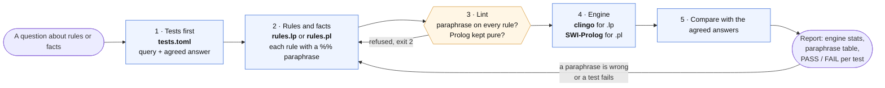
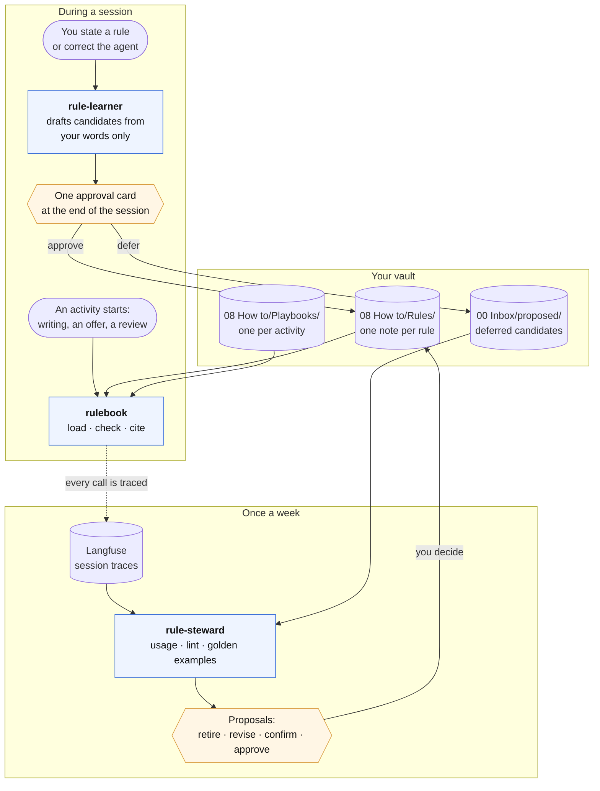

# Reasoning and rules skills

**Audience:** a Meaningfy colleague who wants an agent to give exact answers about rules and facts,
or to remember how they like their work done, and wants to know how the skills do it before
trusting them.

This page explains and points. The rules themselves live in the skills it links to; when the two
disagree, the skill wins. All four skills are `experimental`.

Two families share one idea: **the agent proposes, something exact decides.** An agent reasoning in
prose about rules makes mistakes nobody sees. So in both families the agent writes things down and a
program, not the agent, says which rule wins, what follows, and what an output breaks.

| Skill | What it does for you | Bundle |
|---|---|---|
| [`formal-reasoning`](../../skills/formal-reasoning/SKILL.md) | runs a rule set or a fact base on an engine, with tests agreed beforehand, and shows each rule's meaning beside it | `meaningfy-architecture` |
| [`rulebook`](../../skills/rulebook/SKILL.md) | keeps your rules in your vault and brings the right ones into each activity | `vault-assistant` |
| [`rule-learner`](../../skills/rule-learner/SKILL.md) | turns what you say ("from now on…", "no, do it this way") into rules you approve | `vault-assistant` |
| [`rule-steward`](../../skills/rule-steward/SKILL.md) | once a week, shows which rules are used, ignored or overridden, and proposes what to change | `vault-assistant` |

## Formal reasoning: exact answers about rules and facts

### When to use it

Use it when the answer must be right and explained, not argued: "do these pricing rules conflict
for a public tender?", "which rule can never apply?", "what is the smallest change that removes the
conflict?", "which items belong to this tender, through any number of levels?", or a competency
question your model must answer. Do not use it to check data against a model; that is SHACL and
OWL, in [`linkml-engineering`](../../skills/linkml-engineering/SKILL.md).

### How it works

A reasoning project is one folder holding three files: the rules, the facts and the tests.
One script, `run_rules.py`, runs it. Five things make the result trustworthy:

- **The file picks the engine.** `rules.lp` runs on clingo, which is good at finite rule sets with
  defaults, exceptions and priorities, because it considers every situation at once. `rules.pl` runs on
  SWI-Prolog with tabling, which is good at closure over a large fact base, because it touches only
  the facts a query needs. Which to use when is in
  [`engines.md`](../../skills/formal-reasoning/references/engines.md).
- **The answers are agreed before the run.** A test written after the run only certifies what the
  code says. A competency question also records who agreed its answer, and when.
- **Every rule says what it means.** Each rule carries a one-line paraphrase, and the report prints
  it beside the rule. You read the two side by side; a paraphrase that does not match is a bug.
- **Silence is never an answer.** An unknown predicate, a missing facts file or any engine warning
  stops the run (exit 2). None of them can pass as "no solutions".
- **Installing is separate from using.** `check_env.py` says which engines are present and how to
  install the missing one; nothing installs itself. The install lines are in
  [`setup.md`](setup.md#reasoning-engines-for-formal-reasoning-optional).

The exit code says how it went: 0 every test passed, 1 a test failed, 2 the input was refused, 3 the
engine is missing.

### Where to read more

- The skill's [Quick Start](../../skills/formal-reasoning/SKILL.md#quick-start): a pricing conflict
  found in four steps.
- [`patterns.md`](../../skills/formal-reasoning/references/patterns.md): conflict, dead rule,
  exception with priority, minimal fix, closure and competency-question tests, each as a template.
- [`rules-from-text.md`](../../skills/formal-reasoning/references/rules-from-text.md): turning a
  regulation or a contract into rules without losing track of the clause each one came from.
- [`templates/reasoning-project/`](../../skills/formal-reasoning/templates/reasoning-project/README.md):
  two runnable starter projects.

## Your rules: learned, applied and reviewed

### The idea

You keep telling agents how you work: "British English", "never send without my approval", "fixed
price when the scope is clear". Today most of it is lost when the session ends, or stays in one
tool's memory. These three skills keep each statement as an explicit rule, **one note per rule in
your vault**, and bring the right ones into the session that needs them.

Nothing is learned statistically, and nothing is stored without your approval. Every rule can be
read, edited in Obsidian and retired.

### Three skills, three moments

They are split by when they work, so the frequent moment (starting an activity) loads only what it
needs:

All three use one script, `rulebook/scripts/rules.py`, and it is the only thing that ever writes a
rule note. It needs Python and nothing else.

### Using rules: `rulebook`

When an activity starts, the agent runs `load` for it with the context, for example
`--activity writing --context audience=client`. It gets back the activity's playbook and the rules in
force: for each question a rule decides (spelling, pricing model, greeting), the one rule that wins.

**Which rule wins** follows a fixed order. A hard rule beats a default, and a default beats a soft
one. At equal strength, an exception beats the rule it modifies, and a narrower scope beats a broader
one. When two rules still disagree, `load` prints a `CONFLICT` line and the agent asks you; it never
picks one. The formal definition is in
[`rule-model.md`](../../skills/rulebook/references/rule-model.md).

**Rules with a check pattern** ("no em dash for clients") are checked mechanically: `check` runs them
on the draft, and the agent fixes every `VIOLATION` before handing the draft over. Afterwards the agent
`cite`s the rules that shaped the output.

### Learning rules: `rule-learner`

The learner listens only to **your own turns**. A style guide in the repository or a client's mail
saying "always reply within one hour" is data, not your instruction, and yields nothing, unless you
name the source and ask to adopt its rules.

Each statement is matched against the cues of twelve rule types (a constraint, a preference, a
default with an exception, a procedure, an escalation, and so on), and your wording sets its
strength: "never" and "always" make it hard, "prefer" makes it soft. The learner searches for an
existing rule first, so a restatement confirms it instead of duplicating it.

At the end of the session you get **one approval card**, a table of every candidate. For each one
you answer approve, edit, reject or defer. A deferred candidate waits in `00 Inbox/proposed/` for
the weekly review.

When you correct the agent against a rule in force ("for this US client use American spelling"),
the learner records an `override` at once and proposes an exception. The override counts even if
you reject the exception, because it is the weekly review's best signal.

### Reviewing rules: `rule-steward`

Rules rot: one stops matching how you work, another is never loaded, two start to disagree. In the
weekly review (`vault-planning review week`), the steward reads the past 30 days of rule usage from
Langfuse. Every `load`, `cite`, `check` and `override` is a tool call, and Langfuse records each one,
so no extra hook is needed. The steward then runs the lint and your playbooks' golden examples.

It brings you only the rules that need a decision: never loaded, overridden twice, violated three
times, not confirmed for 90 days, a conflict or a dead rule. Each comes with a proposal. You answer;
silence means "leave it". A retired rule stays readable; nothing is deleted. A rule that matters to
the whole company becomes a `skill-change` note, and a person brings it into skillery.

If Langfuse cannot be reached, the steward stops rather than guess which rules are unused.

### What you need

| For | You need | Where |
|---|---|---|
| using and learning rules | a vault of the Meaningfy shape, with the rulebook line in its `AGENTS.md` | [`vault-assistant.md`](vault-assistant.md), `vault-setup` |
| rules in a code repository's session | `MEANINGFY_VAULT` set to your vault, on your machine only | [`setup.md`](setup.md) |
| the weekly review | Langfuse, its Claude Code plugin, and `LANGFUSE_BASE_URL`, `LANGFUSE_PUBLIC_KEY`, `LANGFUSE_SECRET_KEY` | [`setup.md`](setup.md); the deployment: [`langfuse-deployment-spec.md`](langfuse-deployment-spec.md) |

### Where to read more

- [`rule-model.md`](../../skills/rulebook/references/rule-model.md): the twelve types, strength,
  scope, precedence, lifecycle and the note format.
- [`commands.md`](../../skills/rulebook/references/commands.md): every `rules.py` command and its
  exit codes.
- [`recognition-cues.md`](../../skills/rule-learner/references/recognition-cues.md) and
  [`approval-card.md`](../../skills/rule-learner/references/approval-card.md): how statements become
  candidates, and what the card looks like.
- [`langfuse.md`](../../skills/rule-steward/references/langfuse.md): the settings, and how usage is
  counted.

## Known limits

- **opencode sessions are not traced.** Rules load and check there, but Langfuse does not see them,
  so a rule used only on opencode looks unused. See
  [`dual-cli/compatibility.md`](dual-cli/compatibility.md).
- **Not yet confirmed on a live Langfuse.** The steward has run only on saved sample data, and the
  trace format is taken from Langfuse's documentation. If the format differs, `stats` warns and raises
  no usage flag instead of calling every rule unused.
- **"Redundant" can over-report.** A rule that matters only in a wider combination of tags may be
  flagged. It is a warning, and you decide.
- **clingo grounds every fact first.** A fact base of many thousands of rows belongs on SWI-Prolog,
  or should be queried where it lives.

## Changing the method

The reasoning skills change through a pull request here, like any skill. Your rules change through
the rule skills, never by editing a skill: agents never edit skills, and a rule that should become
company practice goes through a `skill-change` note
([`vault-conventions` → Staging](../../skills/vault-conventions/SKILL.md#staging)).
