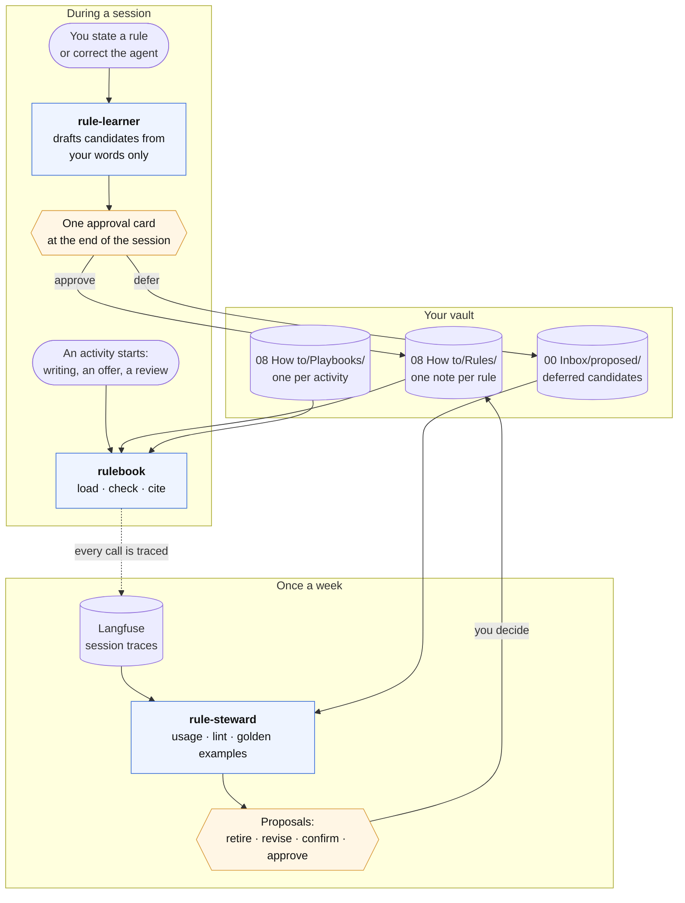

# Your rules for agents

**Audience:** a Meaningfy colleague who wants agents to remember how they like their work done, and
wants to know how the rule skills do it before trusting them.

This page explains and points. The rules themselves live in the skills it links to; when the two
disagree, the skill wins. All three skills are `experimental` and ship in the `meaningfy-core` bundle, so they work in any
session, not only in the vault.

| Skill | What it does for you |
|---|---|
| [`rulebook`](../../skills/rulebook/SKILL.md) | keeps your rules in your vault and brings the right ones into each activity |
| [`rule-learner`](../../skills/rule-learner/SKILL.md) | turns what you say ("from now on…", "no, do it this way") into rules you approve |
| [`rule-steward`](../../skills/rule-steward/SKILL.md) | once a week, shows which rules are used, ignored or overridden, and proposes what to change |

You keep telling agents how you work: "British English", "never send without my approval", "fixed
price when the scope is clear". Today most of it is lost when the session ends, or stays in one
tool's memory. These three skills keep each statement as an explicit rule, **one note per rule in
your vault**, and bring the right ones into the session that needs them.

Nothing is learned statistically, and nothing is stored without your approval. Every rule can be
read, edited in Obsidian and retired.

## Quick Start

You are in `~/work/app`, a code repository, with `MEANINGFY_VAULT` set to your vault.

1. You ask for a pull request description. Your global instructions
   ([`global-prompt.md`](global-prompt.md)) send the agent to `rulebook`, which runs
   `rules.py load --activity code-review` and gets back your rules for that activity, then `-- end --`.
2. You say "from now on, keep PR descriptions under ten lines".
3. Before its final summary of the task, `rule-learner` shows one approval card with that statement as
   a candidate rule. You answer "approve 1".
4. `rules.py add` writes it to your vault as the next `R-` note, and every later session loads it.

If no vault is reachable, `load` says so once and the session carries on without your rules.

## Where your rules work

| Surface | Runs `rules.py` with your vault? |
|---|---|
| Claude Code CLI | yes, on your machine |
| Claude Desktop, Code tab (local) | yes; set `MEANINGFY_VAULT` in the `env` key of `~/.claude/settings.json` ([`setup.md`](setup.md)) |
| Claude Desktop, Cowork | not yet verified |
| Claude Desktop chat, claude.ai | no: skill code runs in an Anthropic container with no path to your machine |
| opencode | yes; sessions are not traced ([Known limits](#known-limits)) |

Scheduled and unattended agents do not load your rules.

## Three skills, three moments

They are split by when they work, so the frequent moment (starting an activity) loads only what it
needs:

All three use one script, `rulebook/scripts/rules.py`, and it is the only thing that ever writes a
rule note. It needs Python and nothing else.

## Using rules: `rulebook`

When an activity starts, the agent runs `load` for it with the context, for example
`--activity writing --context audience=client`. It gets back the activity's playbook and the rules in
force: for each question a rule decides (spelling, pricing model, greeting), the one rule that wins.

**Which rule wins** follows a fixed order. A hard rule beats a default, and a default beats a soft
one. At equal strength, an exception beats the rule it modifies, and a narrower scope beats a broader
one. When two rules still disagree, `load` prints a `CONFLICT` line and the agent asks you; it never
picks one. The formal definition is in
[`rule-model.md`](../../skills/rulebook/references/rule-model.md).

**Rules with a check pattern** ("no em dash for clients") are checked mechanically: `check` runs them
on the draft, and the agent fixes every `VIOLATION` before handing the draft over. Afterwards the agent
`cite`s the rules that shaped the output.

## Learning rules: `rule-learner`

The learner listens only to **your own turns**. A style guide in the repository or a client's mail
saying "always reply within one hour" is data, not your instruction, and yields nothing, unless you
name the source and ask to adopt its rules.

Each statement is matched against the cues of twelve rule types (a constraint, a preference, a
default with an exception, a procedure, an escalation, and so on), and your wording sets its
strength: "never" and "always" make it hard, "prefer" makes it soft. The learner searches for an
existing rule first, so a restatement confirms it instead of duplicating it.

At the end of the session you get **one approval card**, a table of every candidate. For each one
you answer approve, edit, reject or defer. A deferred candidate waits in `00 Inbox/proposed/` for
the weekly review.

When you correct the agent against a rule in force ("for this US client use American spelling"),
the learner records an `override` at once and proposes an exception. The override counts even if
you reject the exception, because it is the weekly review's best signal.

## Reviewing rules: `rule-steward`

Rules rot: one stops matching how you work, another is never loaded, two start to disagree. In the
weekly review (`vault-planning review week`), the steward reads the past 30 days of rule usage from
Langfuse. Every `load`, `cite`, `check` and `override` is a tool call, and Langfuse records each one,
so no extra hook is needed. The steward then runs the lint and your playbooks' golden examples.

It brings you only the rules that need a decision: never loaded, overridden twice, violated three
times, not confirmed for 90 days, a conflict or a dead rule. Each comes with a proposal. You answer;
silence means "leave it". A retired rule stays readable; nothing is deleted. A rule that matters to
the whole company becomes a `skill-change` note, and a person brings it into skillery.

If Langfuse cannot be reached, the steward stops rather than guess which rules are unused.

## What you need

| For | You need | Where |
|---|---|---|
| using and learning rules | `meaningfy-core` installed, and a vault of the Meaningfy shape (see `vault-setup`) | [`vault-assistant.md`](vault-assistant.md), `vault-setup` |
| rules in a code repository's session | `MEANINGFY_VAULT` set to your vault, on your machine only | [`setup.md`](setup.md) |
| the weekly review | Langfuse, its Claude Code plugin, and `LANGFUSE_BASE_URL`, `LANGFUSE_PUBLIC_KEY`, `LANGFUSE_SECRET_KEY` | [`setup.md`](setup.md); the deployment: [`langfuse-deployment-spec.md`](langfuse-deployment-spec.md) |

## Where to read more

- [`rule-model.md`](../../skills/rulebook/references/rule-model.md): the twelve types, strength,
  scope, precedence, lifecycle and the note format.
- [`commands.md`](../../skills/rulebook/references/commands.md): every `rules.py` command and its
  exit codes.
- [`recognition-cues.md`](../../skills/rule-learner/references/recognition-cues.md) and
  [`approval-card.md`](../../skills/rule-learner/references/approval-card.md): how statements become
  candidates, and what the card looks like.
- [`langfuse.md`](../../skills/rule-steward/references/langfuse.md): the settings, and how usage is
  counted.

## Known limits

- **opencode sessions are not traced.** Rules load and check there, but Langfuse does not see them,
  so a rule used only on opencode looks unused. See
  [`dual-cli/compatibility.md`](dual-cli/compatibility.md).
- **Not yet confirmed on a live Langfuse.** The steward has run only on saved sample data, and the
  trace format is taken from Langfuse's documentation. If the format differs, `stats` warns and raises
  no usage flag instead of calling every rule unused.
- **"Redundant" can over-report.** A rule that matters only in a wider combination of tags may be
  flagged. It is a warning, and you decide.
- **Rules reach any interactive session, but only your vault stores them.** A session finds them
  when `MEANINGFY_VAULT` is set (or it runs in the vault). A rule stated in a code repository goes to
  your vault, so a teammate never sees it.

## Changing the method

The rule skills change through a pull request here, like any skill. Your rules change through the
rule skills, never by editing a skill: agents never edit skills, and a rule that should become
company practice goes through a `skill-change` note
([`vault-conventions` → Staging](../../skills/vault-conventions/SKILL.md#staging)).
