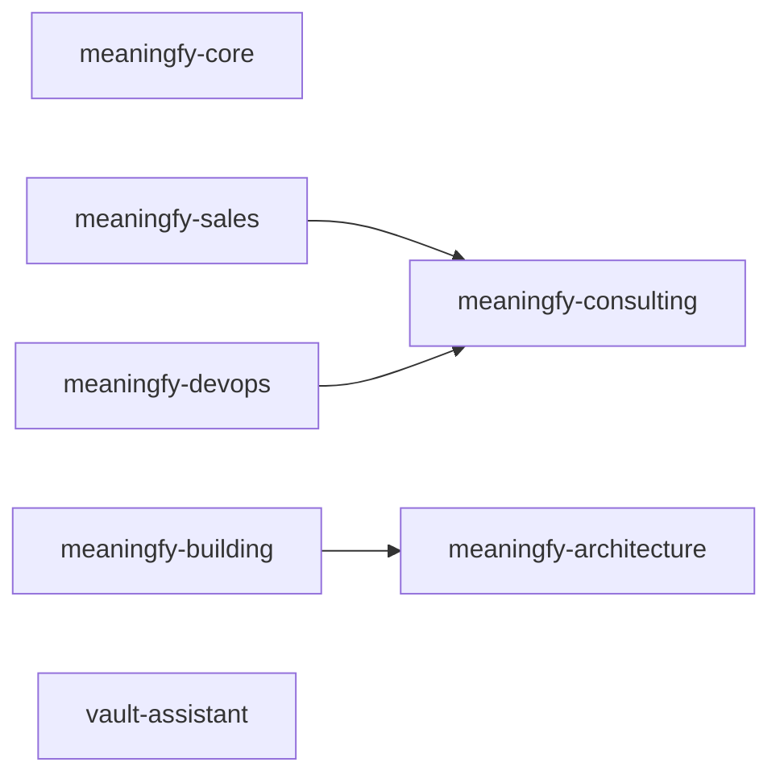

# Catalogue map

<!-- GENERATED by `python -m tools.skill_inventory` (or `make skill-inventory`) —
     DO NOT hand-edit. Source: each skill's SKILL.md frontmatter/body, each
     agent's frontmatter (agents/*.md), bundles.yaml and facets.yaml.
     tests/test_skill_inventory.py fails the build if this drifts. -->

47 skills and 10 agents across 7 bundles (role bundles plus the `vault-assistant` workflow bundle). Install `meaningfy-core` plus the bundle(s) matching your role, and the bundles they require — see [Bundle requirements](#bundle-requirements) and the root [`README.md`](../README.md).

## Map

**Containers** are bundles. **Dark rectangles** are skills; **purple hexagons** are agents. **Light rounded cards** are the `purpose` values in use (from [`facets.yaml`](../facets.yaml)), cutting across bundles — each with its one-line explanation. A solid line is *classified as* (skill or agent → purpose); a dotted line is *loads* (agent → a first-party skill in its `skills:` list).

```mermaid
%%{init: {'flowchart': {'nodeSpacing': 12, 'rankSpacing': 45, 'curve': 'basis'}}}%%
flowchart LR
  subgraph b_meaningfy_core["meaningfy-core"]
    s_technical_writing["technical-writing"]
    s_explanatory_writing["explanatory-writing"]
    s_writing_antipatterns["writing-antipatterns"]
    s_meaningfy_voice["meaningfy-voice"]
    s_meaningfy_git_workflow["meaningfy-git-workflow"]
    s_guardrails["guardrails"]
    s_skillery_feedback["skillery-feedback"]
    s_rulebook["rulebook"]
    s_rule_learner["rule-learner"]
    s_rule_steward["rule-steward"]
  end
  subgraph b_meaningfy_consulting["meaningfy-consulting"]
    s_semantic_consulting_coach["semantic-consulting-coach"]
    s_decision_package["decision-package"]
    s_executive_communication["executive-communication"]
  end
  subgraph b_meaningfy_sales["meaningfy-sales"]
    s_proposal_writing["proposal-writing"]
    s_estimation["estimation"]
    s_sales_pipeline_custody["sales-pipeline-custody"]
    s_sales_accounts["sales-accounts"]
    s_sales_qualification["sales-qualification"]
    s_sales_conversations["sales-conversations"]
    s_sales_operations["sales-operations"]
    a_proposal_writer{{"proposal-writer"}}
    a_sales_agent{{"sales-agent"}}
  end
  subgraph b_meaningfy_architecture["meaningfy-architecture"]
    s_architecture["architecture"]
    s_conceptual_modelling["conceptual-modelling"]
    s_modelling_conventions["modelling-conventions"]
    s_linkml_engineering["linkml-engineering"]
    s_formal_reasoning["formal-reasoning"]
    a_system_architect{{"system-architect"}}
    a_conceptual_modeller{{"conceptual-modeller"}}
  end
  subgraph b_meaningfy_building["meaningfy-building"]
    s_epic_planning["epic-planning"]
    s_spec_stewardship["spec-stewardship"]
    s_clarity_gate["clarity-gate"]
    s_bdd_gherkin["bdd-gherkin"]
    s_meaningfy_code_review["meaningfy-code-review"]
    s_cosmic_python["cosmic-python"]
    s_project_setup["project-setup"]
    s_ci_cd_delivery["ci-cd-delivery"]
    s_meaningfy_release["meaningfy-release"]
    a_epic_planner{{"epic-planner"}}
    a_implementer{{"implementer"}}
    a_code_reviewer{{"code-reviewer"}}
  end
  subgraph b_meaningfy_devops["meaningfy-devops"]
    s_infrastructure_operations["infrastructure-operations"]
    s_stack_operations["stack-operations"]
    s_service_reliability["service-reliability"]
    s_infrastructure_security["infrastructure-security"]
    a_devops_engineer{{"devops-engineer"}}
    a_ops_watch{{"ops-watch"}}
    a_infra_reviewer{{"infra-reviewer"}}
  end
  subgraph b_vault_assistant["vault-assistant"]
    s_vault_setup["vault-setup"]
    s_vault_conventions["vault-conventions"]
    s_vault_project["vault-project"]
    s_vault_resume["vault-resume"]
    s_vault_capture["vault-capture"]
    s_vault_promote["vault-promote"]
    s_vault_tidy["vault-tidy"]
    s_vault_planning["vault-planning"]
    s_vault_daily["vault-daily"]
  end

  p_software_development("software-development<br/><sub>build software with agents: plan, build, test, review, version</sub>")
  p_modelling("modelling<br/><sub>ontology, conceptual and system modelling</sub>")
  p_advising("advising<br/><sub>coach a client's decisions</sub>")
  p_content("content<br/><sub>write and explain for people: docs, posts, blogs, messages</sub>")
  p_offers("offers<br/><sub>commercial offers, packaging, pitch and pricing</sub>")
  p_proposals("proposals<br/><sub>proposal and offer documents</sub>")
  p_crm("crm<br/><sub>create, manage and groom deals and contacts</sub>")
  p_devops("devops<br/><sub>environments, CI/CD, releases and operations</sub>")
  p_knowledge("knowledge<br/><sub>the owner's personal notes, plans and rhythm</sub>")

  s_architecture --> p_modelling
  s_bdd_gherkin --> p_software_development
  s_ci_cd_delivery --> p_devops
  s_clarity_gate --> p_software_development
  s_conceptual_modelling --> p_modelling
  s_cosmic_python --> p_software_development
  s_decision_package --> p_advising
  s_epic_planning --> p_software_development
  s_estimation --> p_offers
  s_executive_communication --> p_content
  s_explanatory_writing --> p_content
  s_formal_reasoning --> p_modelling
  s_guardrails --> p_software_development
  s_infrastructure_operations --> p_devops
  s_infrastructure_security --> p_devops
  s_linkml_engineering --> p_modelling
  s_meaningfy_code_review --> p_software_development
  s_meaningfy_git_workflow --> p_software_development
  s_meaningfy_release --> p_devops
  s_meaningfy_voice --> p_content
  s_modelling_conventions --> p_modelling
  s_project_setup --> p_software_development
  s_proposal_writing --> p_proposals
  s_rule_learner --> p_knowledge
  s_rule_steward --> p_knowledge
  s_rulebook --> p_knowledge
  s_sales_accounts --> p_crm
  s_sales_conversations --> p_offers
  s_sales_operations --> p_crm
  s_sales_pipeline_custody --> p_crm
  s_sales_qualification --> p_crm
  s_semantic_consulting_coach --> p_advising
  s_service_reliability --> p_devops
  s_skillery_feedback --> p_knowledge
  s_spec_stewardship --> p_software_development
  s_stack_operations --> p_devops
  s_technical_writing --> p_content
  s_vault_capture --> p_knowledge
  s_vault_conventions --> p_knowledge
  s_vault_daily --> p_knowledge
  s_vault_planning --> p_knowledge
  s_vault_project --> p_knowledge
  s_vault_promote --> p_knowledge
  s_vault_resume --> p_knowledge
  s_vault_setup --> p_knowledge
  s_vault_tidy --> p_knowledge
  s_writing_antipatterns --> p_content
  a_proposal_writer --> p_proposals
  a_sales_agent --> p_crm
  a_system_architect --> p_modelling
  a_conceptual_modeller --> p_modelling
  a_epic_planner --> p_software_development
  a_implementer --> p_software_development
  a_code_reviewer --> p_software_development
  a_devops_engineer --> p_devops
  a_ops_watch --> p_devops
  a_infra_reviewer --> p_devops

  a_proposal_writer -.-> s_proposal_writing
  a_proposal_writer -.-> s_estimation
  a_proposal_writer -.-> s_executive_communication
  a_sales_agent -.-> s_sales_operations
  a_sales_agent -.-> s_sales_pipeline_custody
  a_sales_agent -.-> s_sales_accounts
  a_sales_agent -.-> s_sales_qualification
  a_sales_agent -.-> s_sales_conversations
  a_system_architect -.-> s_architecture
  a_system_architect -.-> s_modelling_conventions
  a_system_architect -.-> s_conceptual_modelling
  a_conceptual_modeller -.-> s_conceptual_modelling
  a_conceptual_modeller -.-> s_modelling_conventions
  a_conceptual_modeller -.-> s_linkml_engineering
  a_epic_planner -.-> s_epic_planning
  a_epic_planner -.-> s_clarity_gate
  a_epic_planner -.-> s_bdd_gherkin
  a_implementer -.-> s_cosmic_python
  a_code_reviewer -.-> s_meaningfy_code_review
  a_code_reviewer -.-> s_cosmic_python
  a_devops_engineer -.-> s_infrastructure_operations
  a_devops_engineer -.-> s_stack_operations
  a_devops_engineer -.-> s_service_reliability
  a_devops_engineer -.-> s_infrastructure_security
  a_ops_watch -.-> s_service_reliability
  a_ops_watch -.-> s_stack_operations
  a_ops_watch -.-> s_infrastructure_operations
  a_ops_watch -.-> s_infrastructure_security
  a_infra_reviewer -.-> s_infrastructure_operations
  a_infra_reviewer -.-> s_stack_operations
  a_infra_reviewer -.-> s_infrastructure_security

  style b_meaningfy_core fill:#eaf3ff,stroke:#999,stroke-width:1px
  style b_meaningfy_consulting fill:#fff2e0,stroke:#999,stroke-width:1px
  style b_meaningfy_sales fill:#eafaf0,stroke:#999,stroke-width:1px
  style b_meaningfy_architecture fill:#f5eaff,stroke:#999,stroke-width:1px
  style b_meaningfy_building fill:#eaf3ff,stroke:#999,stroke-width:1px
  style b_meaningfy_devops fill:#fff2e0,stroke:#999,stroke-width:1px
  style b_vault_assistant fill:#eafaf0,stroke:#999,stroke-width:1px
  style p_software_development fill:#fdf6e3,color:#000000,stroke:#333,stroke-width:1.5px
  style p_modelling fill:#fdeef7,color:#000000,stroke:#333,stroke-width:1.5px
  style p_advising fill:#eafaf5,color:#000000,stroke:#333,stroke-width:1.5px
  style p_content fill:#eef1fb,color:#000000,stroke:#333,stroke-width:1.5px
  style p_offers fill:#f1f8e9,color:#000000,stroke:#333,stroke-width:1.5px
  style p_proposals fill:#fdeef0,color:#000000,stroke:#333,stroke-width:1.5px
  style p_crm fill:#f6f5ef,color:#000000,stroke:#333,stroke-width:1.5px
  style p_devops fill:#eef7fb,color:#000000,stroke:#333,stroke-width:1.5px
  style p_knowledge fill:#fdf6e3,color:#000000,stroke:#333,stroke-width:1.5px
  style s_architecture fill:#1e1e1e,color:#ffffff,stroke:#000
  style s_bdd_gherkin fill:#1e1e1e,color:#ffffff,stroke:#000
  style s_ci_cd_delivery fill:#1e1e1e,color:#ffffff,stroke:#000
  style s_clarity_gate fill:#1e1e1e,color:#ffffff,stroke:#000
  style s_conceptual_modelling fill:#1e1e1e,color:#ffffff,stroke:#000
  style s_cosmic_python fill:#1e1e1e,color:#ffffff,stroke:#000
  style s_decision_package fill:#1e1e1e,color:#ffffff,stroke:#000
  style s_epic_planning fill:#1e1e1e,color:#ffffff,stroke:#000
  style s_estimation fill:#1e1e1e,color:#ffffff,stroke:#000
  style s_executive_communication fill:#1e1e1e,color:#ffffff,stroke:#000
  style s_explanatory_writing fill:#1e1e1e,color:#ffffff,stroke:#000
  style s_formal_reasoning fill:#1e1e1e,color:#ffffff,stroke:#000
  style s_guardrails fill:#1e1e1e,color:#ffffff,stroke:#000
  style s_infrastructure_operations fill:#1e1e1e,color:#ffffff,stroke:#000
  style s_infrastructure_security fill:#1e1e1e,color:#ffffff,stroke:#000
  style s_linkml_engineering fill:#1e1e1e,color:#ffffff,stroke:#000
  style s_meaningfy_code_review fill:#1e1e1e,color:#ffffff,stroke:#000
  style s_meaningfy_git_workflow fill:#1e1e1e,color:#ffffff,stroke:#000
  style s_meaningfy_release fill:#1e1e1e,color:#ffffff,stroke:#000
  style s_meaningfy_voice fill:#1e1e1e,color:#ffffff,stroke:#000
  style s_modelling_conventions fill:#1e1e1e,color:#ffffff,stroke:#000
  style s_project_setup fill:#1e1e1e,color:#ffffff,stroke:#000
  style s_proposal_writing fill:#1e1e1e,color:#ffffff,stroke:#000
  style s_rule_learner fill:#1e1e1e,color:#ffffff,stroke:#000
  style s_rule_steward fill:#1e1e1e,color:#ffffff,stroke:#000
  style s_rulebook fill:#1e1e1e,color:#ffffff,stroke:#000
  style s_sales_accounts fill:#1e1e1e,color:#ffffff,stroke:#000
  style s_sales_conversations fill:#1e1e1e,color:#ffffff,stroke:#000
  style s_sales_operations fill:#1e1e1e,color:#ffffff,stroke:#000
  style s_sales_pipeline_custody fill:#1e1e1e,color:#ffffff,stroke:#000
  style s_sales_qualification fill:#1e1e1e,color:#ffffff,stroke:#000
  style s_semantic_consulting_coach fill:#1e1e1e,color:#ffffff,stroke:#000
  style s_service_reliability fill:#1e1e1e,color:#ffffff,stroke:#000
  style s_skillery_feedback fill:#1e1e1e,color:#ffffff,stroke:#000
  style s_spec_stewardship fill:#1e1e1e,color:#ffffff,stroke:#000
  style s_stack_operations fill:#1e1e1e,color:#ffffff,stroke:#000
  style s_technical_writing fill:#1e1e1e,color:#ffffff,stroke:#000
  style s_vault_capture fill:#1e1e1e,color:#ffffff,stroke:#000
  style s_vault_conventions fill:#1e1e1e,color:#ffffff,stroke:#000
  style s_vault_daily fill:#1e1e1e,color:#ffffff,stroke:#000
  style s_vault_planning fill:#1e1e1e,color:#ffffff,stroke:#000
  style s_vault_project fill:#1e1e1e,color:#ffffff,stroke:#000
  style s_vault_promote fill:#1e1e1e,color:#ffffff,stroke:#000
  style s_vault_resume fill:#1e1e1e,color:#ffffff,stroke:#000
  style s_vault_setup fill:#1e1e1e,color:#ffffff,stroke:#000
  style s_vault_tidy fill:#1e1e1e,color:#ffffff,stroke:#000
  style s_writing_antipatterns fill:#1e1e1e,color:#ffffff,stroke:#000
  style a_proposal_writer fill:#5a2d82,color:#ffffff,stroke:#000
  style a_sales_agent fill:#5a2d82,color:#ffffff,stroke:#000
  style a_system_architect fill:#5a2d82,color:#ffffff,stroke:#000
  style a_conceptual_modeller fill:#5a2d82,color:#ffffff,stroke:#000
  style a_epic_planner fill:#5a2d82,color:#ffffff,stroke:#000
  style a_implementer fill:#5a2d82,color:#ffffff,stroke:#000
  style a_code_reviewer fill:#5a2d82,color:#ffffff,stroke:#000
  style a_devops_engineer fill:#5a2d82,color:#ffffff,stroke:#000
  style a_ops_watch fill:#5a2d82,color:#ffffff,stroke:#000
  style a_infra_reviewer fill:#5a2d82,color:#ffffff,stroke:#000
```



## Bundle requirements

An arrow is *requires* (bundle → bundle it needs installed too), from `requires:` in [`bundles.yaml`](../bundles.yaml). Every bundle implicitly requires `meaningfy-core`, which is never drawn.



## Relations

Same bundle containers as the Map, but skill boxes are now colour-coded by **purpose** (one dark shade per value) instead of uniform dark — at this many edges, colour is what makes the grouping legible without tracing every line. Two line types, not one: a **thick solid** arrow is *depends on* (72 edges, mechanically parsed from each skill's own "Delegates" text — a skill explicitly handing something off to another); a **thin dashed** arrow is *related* (187 edges, everything else in the "Related" list — weaker, a "see also" rather than a hand-off). Kept separate from the Map's classification edges — 259 relation edges plus 47 classification edges in one diagram was tried and was a long-crossing-line mess, confirmed by actually rendering it.

```mermaid
%%{init: {'flowchart': {'nodeSpacing': 12, 'rankSpacing': 45, 'curve': 'basis'}}}%%
flowchart LR
  subgraph b_meaningfy_core["meaningfy-core"]
    s_technical_writing["technical-writing"]
    s_explanatory_writing["explanatory-writing"]
    s_writing_antipatterns["writing-antipatterns"]
    s_meaningfy_voice["meaningfy-voice"]
    s_meaningfy_git_workflow["meaningfy-git-workflow"]
    s_guardrails["guardrails"]
    s_skillery_feedback["skillery-feedback"]
    s_rulebook["rulebook"]
    s_rule_learner["rule-learner"]
    s_rule_steward["rule-steward"]
  end
  subgraph b_meaningfy_consulting["meaningfy-consulting"]
    s_semantic_consulting_coach["semantic-consulting-coach"]
    s_decision_package["decision-package"]
    s_executive_communication["executive-communication"]
  end
  subgraph b_meaningfy_sales["meaningfy-sales"]
    s_proposal_writing["proposal-writing"]
    s_estimation["estimation"]
    s_sales_pipeline_custody["sales-pipeline-custody"]
    s_sales_accounts["sales-accounts"]
    s_sales_qualification["sales-qualification"]
    s_sales_conversations["sales-conversations"]
    s_sales_operations["sales-operations"]
  end
  subgraph b_meaningfy_architecture["meaningfy-architecture"]
    s_architecture["architecture"]
    s_conceptual_modelling["conceptual-modelling"]
    s_modelling_conventions["modelling-conventions"]
    s_linkml_engineering["linkml-engineering"]
    s_formal_reasoning["formal-reasoning"]
  end
  subgraph b_meaningfy_building["meaningfy-building"]
    s_epic_planning["epic-planning"]
    s_spec_stewardship["spec-stewardship"]
    s_clarity_gate["clarity-gate"]
    s_bdd_gherkin["bdd-gherkin"]
    s_meaningfy_code_review["meaningfy-code-review"]
    s_cosmic_python["cosmic-python"]
    s_project_setup["project-setup"]
    s_ci_cd_delivery["ci-cd-delivery"]
    s_meaningfy_release["meaningfy-release"]
  end
  subgraph b_meaningfy_devops["meaningfy-devops"]
    s_infrastructure_operations["infrastructure-operations"]
    s_stack_operations["stack-operations"]
    s_service_reliability["service-reliability"]
    s_infrastructure_security["infrastructure-security"]
  end
  subgraph b_vault_assistant["vault-assistant"]
    s_vault_setup["vault-setup"]
    s_vault_conventions["vault-conventions"]
    s_vault_project["vault-project"]
    s_vault_resume["vault-resume"]
    s_vault_capture["vault-capture"]
    s_vault_promote["vault-promote"]
    s_vault_tidy["vault-tidy"]
    s_vault_planning["vault-planning"]
    s_vault_daily["vault-daily"]
  end

  s_ci_cd_delivery ==> s_project_setup
  s_ci_cd_delivery ==> s_cosmic_python
  s_conceptual_modelling ==> s_linkml_engineering
  s_conceptual_modelling ==> s_architecture
  s_conceptual_modelling ==> s_formal_reasoning
  s_cosmic_python ==> s_architecture
  s_cosmic_python ==> s_conceptual_modelling
  s_cosmic_python ==> s_linkml_engineering
  s_cosmic_python ==> s_meaningfy_git_workflow
  s_cosmic_python ==> s_guardrails
  s_decision_package ==> s_semantic_consulting_coach
  s_decision_package ==> s_executive_communication
  s_epic_planning ==> s_clarity_gate
  s_epic_planning ==> s_spec_stewardship
  s_epic_planning ==> s_bdd_gherkin
  s_epic_planning ==> s_cosmic_python
  s_epic_planning ==> s_technical_writing
  s_epic_planning ==> s_explanatory_writing
  s_estimation ==> s_proposal_writing
  s_estimation ==> s_decision_package
  s_executive_communication ==> s_technical_writing
  s_executive_communication ==> s_meaningfy_voice
  s_linkml_engineering ==> s_conceptual_modelling
  s_linkml_engineering ==> s_formal_reasoning
  s_modelling_conventions ==> s_conceptual_modelling
  s_modelling_conventions ==> s_linkml_engineering
  s_project_setup ==> s_cosmic_python
  s_project_setup ==> s_architecture
  s_project_setup ==> s_conceptual_modelling
  s_project_setup ==> s_ci_cd_delivery
  s_project_setup ==> s_epic_planning
  s_project_setup ==> s_technical_writing
  s_project_setup ==> s_meaningfy_git_workflow
  s_proposal_writing ==> s_estimation
  s_proposal_writing ==> s_executive_communication
  s_proposal_writing ==> s_decision_package
  s_proposal_writing ==> s_semantic_consulting_coach
  s_rule_learner ==> s_rulebook
  s_rule_learner ==> s_rule_steward
  s_rule_steward ==> s_rulebook
  s_rule_steward ==> s_rule_learner
  s_rulebook ==> s_rule_learner
  s_rulebook ==> s_rule_steward
  s_semantic_consulting_coach ==> s_executive_communication
  s_semantic_consulting_coach ==> s_decision_package
  s_spec_stewardship ==> s_epic_planning
  s_spec_stewardship ==> s_clarity_gate
  s_vault_capture ==> s_vault_conventions
  s_vault_capture ==> s_vault_resume
  s_vault_capture ==> s_vault_project
  s_vault_conventions ==> s_vault_setup
  s_vault_daily ==> s_vault_conventions
  s_vault_daily ==> s_vault_planning
  s_vault_daily ==> s_meaningfy_voice
  s_vault_daily ==> s_vault_setup
  s_vault_planning ==> s_vault_conventions
  s_vault_planning ==> s_vault_daily
  s_vault_planning ==> s_vault_promote
  s_vault_planning ==> s_vault_tidy
  s_vault_project ==> s_vault_conventions
  s_vault_project ==> s_vault_resume
  s_vault_project ==> s_vault_capture
  s_vault_promote ==> s_vault_conventions
  s_vault_promote ==> s_vault_tidy
  s_vault_promote ==> s_rulebook
  s_vault_resume ==> s_vault_conventions
  s_vault_resume ==> s_vault_capture
  s_vault_resume ==> s_vault_project
  s_vault_setup ==> s_vault_conventions
  s_vault_tidy ==> s_vault_conventions
  s_vault_tidy ==> s_vault_promote
  s_vault_tidy ==> s_vault_project

  s_architecture -.-> s_cosmic_python
  s_architecture -.-> s_epic_planning
  s_architecture -.-> s_writing_antipatterns
  s_architecture -.-> s_bdd_gherkin
  s_architecture -.-> s_conceptual_modelling
  s_architecture -.-> s_linkml_engineering
  s_bdd_gherkin -.-> s_architecture
  s_bdd_gherkin -.-> s_epic_planning
  s_bdd_gherkin -.-> s_clarity_gate
  s_bdd_gherkin -.-> s_spec_stewardship
  s_bdd_gherkin -.-> s_cosmic_python
  s_ci_cd_delivery -.-> s_stack_operations
  s_ci_cd_delivery -.-> s_infrastructure_security
  s_ci_cd_delivery -.-> s_meaningfy_release
  s_clarity_gate -.-> s_epic_planning
  s_clarity_gate -.-> s_bdd_gherkin
  s_clarity_gate -.-> s_spec_stewardship
  s_clarity_gate -.-> s_guardrails
  s_clarity_gate -.-> s_technical_writing
  s_conceptual_modelling -.-> s_modelling_conventions
  s_conceptual_modelling -.-> s_cosmic_python
  s_cosmic_python -.-> s_meaningfy_code_review
  s_cosmic_python -.-> s_bdd_gherkin
  s_cosmic_python -.-> s_ci_cd_delivery
  s_decision_package -.-> s_proposal_writing
  s_decision_package -.-> s_estimation
  s_decision_package -.-> s_writing_antipatterns
  s_epic_planning -.-> s_architecture
  s_estimation -.-> s_sales_qualification
  s_estimation -.-> s_sales_conversations
  s_executive_communication -.-> s_proposal_writing
  s_executive_communication -.-> s_sales_operations
  s_executive_communication -.-> s_sales_pipeline_custody
  s_executive_communication -.-> s_sales_accounts
  s_executive_communication -.-> s_sales_conversations
  s_executive_communication -.-> s_decision_package
  s_executive_communication -.-> s_semantic_consulting_coach
  s_executive_communication -.-> s_explanatory_writing
  s_executive_communication -.-> s_writing_antipatterns
  s_explanatory_writing -.-> s_meaningfy_voice
  s_explanatory_writing -.-> s_technical_writing
  s_explanatory_writing -.-> s_executive_communication
  s_explanatory_writing -.-> s_writing_antipatterns
  s_formal_reasoning -.-> s_conceptual_modelling
  s_formal_reasoning -.-> s_linkml_engineering
  s_formal_reasoning -.-> s_bdd_gherkin
  s_formal_reasoning -.-> s_clarity_gate
  s_guardrails -.-> s_clarity_gate
  s_guardrails -.-> s_cosmic_python
  s_guardrails -.-> s_meaningfy_code_review
  s_guardrails -.-> s_sales_pipeline_custody
  s_guardrails -.-> s_sales_operations
  s_infrastructure_operations -.-> s_stack_operations
  s_infrastructure_operations -.-> s_service_reliability
  s_infrastructure_operations -.-> s_infrastructure_security
  s_infrastructure_operations -.-> s_ci_cd_delivery
  s_infrastructure_operations -.-> s_meaningfy_git_workflow
  s_infrastructure_operations -.-> s_executive_communication
  s_infrastructure_operations -.-> s_epic_planning
  s_infrastructure_operations -.-> s_spec_stewardship
  s_infrastructure_operations -.-> s_clarity_gate
  s_infrastructure_security -.-> s_infrastructure_operations
  s_infrastructure_security -.-> s_stack_operations
  s_infrastructure_security -.-> s_service_reliability
  s_infrastructure_security -.-> s_meaningfy_release
  s_infrastructure_security -.-> s_guardrails
  s_infrastructure_security -.-> s_ci_cd_delivery
  s_linkml_engineering -.-> s_modelling_conventions
  s_linkml_engineering -.-> s_architecture
  s_linkml_engineering -.-> s_cosmic_python
  s_linkml_engineering -.-> s_project_setup
  s_meaningfy_code_review -.-> s_cosmic_python
  s_meaningfy_code_review -.-> s_guardrails
  s_meaningfy_code_review -.-> s_meaningfy_git_workflow
  s_meaningfy_git_workflow -.-> s_cosmic_python
  s_meaningfy_git_workflow -.-> s_meaningfy_release
  s_meaningfy_git_workflow -.-> s_meaningfy_code_review
  s_meaningfy_release -.-> s_meaningfy_git_workflow
  s_meaningfy_release -.-> s_ci_cd_delivery
  s_meaningfy_release -.-> s_project_setup
  s_meaningfy_voice -.-> s_executive_communication
  s_meaningfy_voice -.-> s_explanatory_writing
  s_meaningfy_voice -.-> s_writing_antipatterns
  s_meaningfy_voice -.-> s_vault_daily
  s_meaningfy_voice -.-> s_sales_conversations
  s_project_setup -.-> s_meaningfy_release
  s_project_setup -.-> s_linkml_engineering
  s_proposal_writing -.-> s_sales_qualification
  s_proposal_writing -.-> s_sales_conversations
  s_proposal_writing -.-> s_writing_antipatterns
  s_rule_learner -.-> s_vault_capture
  s_rule_learner -.-> s_vault_conventions
  s_rule_steward -.-> s_vault_planning
  s_rule_steward -.-> s_vault_conventions
  s_rulebook -.-> s_vault_conventions
  s_rulebook -.-> s_vault_setup
  s_sales_accounts -.-> s_sales_pipeline_custody
  s_sales_accounts -.-> s_sales_qualification
  s_sales_accounts -.-> s_sales_conversations
  s_sales_accounts -.-> s_sales_operations
  s_sales_accounts -.-> s_executive_communication
  s_sales_conversations -.-> s_sales_qualification
  s_sales_conversations -.-> s_sales_accounts
  s_sales_conversations -.-> s_sales_pipeline_custody
  s_sales_conversations -.-> s_sales_operations
  s_sales_conversations -.-> s_meaningfy_voice
  s_sales_conversations -.-> s_executive_communication
  s_sales_conversations -.-> s_proposal_writing
  s_sales_conversations -.-> s_estimation
  s_sales_conversations -.-> s_semantic_consulting_coach
  s_sales_operations -.-> s_sales_pipeline_custody
  s_sales_operations -.-> s_sales_accounts
  s_sales_operations -.-> s_sales_qualification
  s_sales_operations -.-> s_sales_conversations
  s_sales_operations -.-> s_executive_communication
  s_sales_operations -.-> s_vault_conventions
  s_sales_operations -.-> s_guardrails
  s_sales_pipeline_custody -.-> s_sales_operations
  s_sales_pipeline_custody -.-> s_sales_accounts
  s_sales_pipeline_custody -.-> s_sales_qualification
  s_sales_pipeline_custody -.-> s_sales_conversations
  s_sales_pipeline_custody -.-> s_guardrails
  s_sales_pipeline_custody -.-> s_executive_communication
  s_sales_pipeline_custody -.-> s_semantic_consulting_coach
  s_sales_qualification -.-> s_sales_accounts
  s_sales_qualification -.-> s_sales_pipeline_custody
  s_sales_qualification -.-> s_sales_conversations
  s_sales_qualification -.-> s_sales_operations
  s_sales_qualification -.-> s_semantic_consulting_coach
  s_sales_qualification -.-> s_proposal_writing
  s_sales_qualification -.-> s_estimation
  s_semantic_consulting_coach -.-> s_proposal_writing
  s_semantic_consulting_coach -.-> s_sales_qualification
  s_semantic_consulting_coach -.-> s_sales_conversations
  s_semantic_consulting_coach -.-> s_sales_pipeline_custody
  s_semantic_consulting_coach -.-> s_writing_antipatterns
  s_service_reliability -.-> s_infrastructure_operations
  s_service_reliability -.-> s_stack_operations
  s_service_reliability -.-> s_infrastructure_security
  s_service_reliability -.-> s_executive_communication
  s_skillery_feedback -.-> s_meaningfy_git_workflow
  s_skillery_feedback -.-> s_guardrails
  s_spec_stewardship -.-> s_bdd_gherkin
  s_stack_operations -.-> s_infrastructure_operations
  s_stack_operations -.-> s_service_reliability
  s_stack_operations -.-> s_infrastructure_security
  s_stack_operations -.-> s_ci_cd_delivery
  s_stack_operations -.-> s_bdd_gherkin
  s_stack_operations -.-> s_meaningfy_git_workflow
  s_technical_writing -.-> s_clarity_gate
  s_technical_writing -.-> s_epic_planning
  s_technical_writing -.-> s_explanatory_writing
  s_technical_writing -.-> s_writing_antipatterns
  s_technical_writing -.-> s_executive_communication
  s_vault_capture -.-> s_vault_daily
  s_vault_capture -.-> s_vault_promote
  s_vault_capture -.-> s_rule_learner
  s_vault_conventions -.-> s_vault_project
  s_vault_conventions -.-> s_vault_resume
  s_vault_conventions -.-> s_vault_capture
  s_vault_conventions -.-> s_vault_promote
  s_vault_conventions -.-> s_vault_tidy
  s_vault_conventions -.-> s_vault_planning
  s_vault_conventions -.-> s_vault_daily
  s_vault_conventions -.-> s_rulebook
  s_vault_conventions -.-> s_rule_learner
  s_vault_conventions -.-> s_rule_steward
  s_vault_conventions -.-> s_sales_operations
  s_vault_daily -.-> s_vault_capture
  s_vault_daily -.-> s_vault_resume
  s_vault_planning -.-> s_vault_project
  s_vault_planning -.-> s_rule_steward
  s_vault_project -.-> s_vault_tidy
  s_vault_project -.-> s_vault_planning
  s_vault_promote -.-> s_vault_capture
  s_vault_promote -.-> s_vault_planning
  s_vault_resume -.-> s_vault_daily
  s_vault_setup -.-> s_vault_daily
  s_vault_setup -.-> s_rulebook
  s_writing_antipatterns -.-> s_meaningfy_voice
  s_writing_antipatterns -.-> s_technical_writing
  s_writing_antipatterns -.-> s_explanatory_writing
  s_writing_antipatterns -.-> s_executive_communication
  s_writing_antipatterns -.-> s_proposal_writing
  s_writing_antipatterns -.-> s_decision_package
  s_writing_antipatterns -.-> s_architecture
  s_writing_antipatterns -.-> s_semantic_consulting_coach

  style b_meaningfy_core fill:#eaf3ff,stroke:#999,stroke-width:1px
  style b_meaningfy_consulting fill:#fff2e0,stroke:#999,stroke-width:1px
  style b_meaningfy_sales fill:#eafaf0,stroke:#999,stroke-width:1px
  style b_meaningfy_architecture fill:#f5eaff,stroke:#999,stroke-width:1px
  style b_meaningfy_building fill:#eaf3ff,stroke:#999,stroke-width:1px
  style b_meaningfy_devops fill:#fff2e0,stroke:#999,stroke-width:1px
  style b_vault_assistant fill:#eafaf0,stroke:#999,stroke-width:1px
  style s_architecture fill:#6b1f4d,color:#ffffff,stroke:#000
  style s_bdd_gherkin fill:#7a5c00,color:#ffffff,stroke:#000
  style s_ci_cd_delivery fill:#1f4f6b,color:#ffffff,stroke:#000
  style s_clarity_gate fill:#7a5c00,color:#ffffff,stroke:#000
  style s_conceptual_modelling fill:#6b1f4d,color:#ffffff,stroke:#000
  style s_cosmic_python fill:#7a5c00,color:#ffffff,stroke:#000
  style s_decision_package fill:#0f5c48,color:#ffffff,stroke:#000
  style s_epic_planning fill:#7a5c00,color:#ffffff,stroke:#000
  style s_estimation fill:#3d5c1f,color:#ffffff,stroke:#000
  style s_executive_communication fill:#2b3a67,color:#ffffff,stroke:#000
  style s_explanatory_writing fill:#2b3a67,color:#ffffff,stroke:#000
  style s_formal_reasoning fill:#6b1f4d,color:#ffffff,stroke:#000
  style s_guardrails fill:#7a5c00,color:#ffffff,stroke:#000
  style s_infrastructure_operations fill:#1f4f6b,color:#ffffff,stroke:#000
  style s_infrastructure_security fill:#1f4f6b,color:#ffffff,stroke:#000
  style s_linkml_engineering fill:#6b1f4d,color:#ffffff,stroke:#000
  style s_meaningfy_code_review fill:#7a5c00,color:#ffffff,stroke:#000
  style s_meaningfy_git_workflow fill:#7a5c00,color:#ffffff,stroke:#000
  style s_meaningfy_release fill:#1f4f6b,color:#ffffff,stroke:#000
  style s_meaningfy_voice fill:#2b3a67,color:#ffffff,stroke:#000
  style s_modelling_conventions fill:#6b1f4d,color:#ffffff,stroke:#000
  style s_project_setup fill:#7a5c00,color:#ffffff,stroke:#000
  style s_proposal_writing fill:#7a2030,color:#ffffff,stroke:#000
  style s_rule_learner fill:#7a5c00,color:#ffffff,stroke:#000
  style s_rule_steward fill:#7a5c00,color:#ffffff,stroke:#000
  style s_rulebook fill:#7a5c00,color:#ffffff,stroke:#000
  style s_sales_accounts fill:#4a4a3a,color:#ffffff,stroke:#000
  style s_sales_conversations fill:#3d5c1f,color:#ffffff,stroke:#000
  style s_sales_operations fill:#4a4a3a,color:#ffffff,stroke:#000
  style s_sales_pipeline_custody fill:#4a4a3a,color:#ffffff,stroke:#000
  style s_sales_qualification fill:#4a4a3a,color:#ffffff,stroke:#000
  style s_semantic_consulting_coach fill:#0f5c48,color:#ffffff,stroke:#000
  style s_service_reliability fill:#1f4f6b,color:#ffffff,stroke:#000
  style s_skillery_feedback fill:#7a5c00,color:#ffffff,stroke:#000
  style s_spec_stewardship fill:#7a5c00,color:#ffffff,stroke:#000
  style s_stack_operations fill:#1f4f6b,color:#ffffff,stroke:#000
  style s_technical_writing fill:#2b3a67,color:#ffffff,stroke:#000
  style s_vault_capture fill:#7a5c00,color:#ffffff,stroke:#000
  style s_vault_conventions fill:#7a5c00,color:#ffffff,stroke:#000
  style s_vault_daily fill:#7a5c00,color:#ffffff,stroke:#000
  style s_vault_planning fill:#7a5c00,color:#ffffff,stroke:#000
  style s_vault_project fill:#7a5c00,color:#ffffff,stroke:#000
  style s_vault_promote fill:#7a5c00,color:#ffffff,stroke:#000
  style s_vault_resume fill:#7a5c00,color:#ffffff,stroke:#000
  style s_vault_setup fill:#7a5c00,color:#ffffff,stroke:#000
  style s_vault_tidy fill:#7a5c00,color:#ffffff,stroke:#000
  style s_writing_antipatterns fill:#2b3a67,color:#ffffff,stroke:#000
```

## meaningfy-core

Cross-cutting basics everyone installs: clear technical writing, explanatory-writing craft, the writing antipatterns catalogue, the Meaningfy company voice, the Meaningfy git/PR workflow, agentic guardrails, how to report a skill or agent problem to skillery, and your own rules for agents: load, learn and groom them (rulebook, rule-learner, rule-steward).

| Skill / agent | Summary | purpose | area | subject | posture | stage | maturity | Depends on / loads | Related |
|---|---|---|---|---|---|---|---|---|---|
| [`technical-writing`](../skills/technical-writing/SKILL.md) | Produce clear documentation, explanations, summaries, and docstrings — AsciiDoc/Antora or Markdown — with a lightweight clarity check. | `content` | `cross-cutting` | `generic` | `reusable` | `any` | `stable` | — | `clarity-gate`, `epic-planning`, `explanatory-writing`, `writing-antipatterns`, `executive-communication` |
| [`explanatory-writing`](../skills/explanatory-writing/SKILL.md) | Apply explanatory craft so that Explanation-quadrant prose reads clearly — one controlling metaphor, a concrete example beside every abstract claim, self-answered question pivots, short declaratives, coin-and-explain, a confident grounded close. | `content` | `cross-cutting` | `generic` | `reusable` | `any` | `stable` | — | `meaningfy-voice`, `technical-writing`, `executive-communication`, `writing-antipatterns` |
| [`writing-antipatterns`](../skills/writing-antipatterns/SKILL.md) | The register/genre-conditional catalogue of how writing fails — a genre map (Tutorial, How-to, Reference, Explanation, Decision, Decision record, Contract/specification, Coaching dialogue), a short list of defects that apply regardless of genre, and an inversion matrix of antipatterns whose correctness depends on genre (a rhetorical question is craft in an explainer and a defect in an ADR). | `content` | `cross-cutting` | `generic` | `reusable` | `any` | `stable` | — | `meaningfy-voice`, `technical-writing`, `explanatory-writing`, `executive-communication`, `proposal-writing`, `decision-package`, `architecture`, `semantic-consulting-coach` |
| [`meaningfy-voice`](../skills/meaningfy-voice/SKILL.md) | The Meaningfy company voice profile — British English, no em dash, plain current vocabulary, honest and direct, the SMILE values, and the register rule (teach, decide, bind). | `content` | `cross-cutting` | `generic` | `precise` | `any` | `stable` | — | `executive-communication`, `explanatory-writing`, `writing-antipatterns`, `vault-daily`, `sales-conversations` |
| [`meaningfy-git-workflow`](../skills/meaningfy-git-workflow/SKILL.md) | Meaningfy git and GitHub conventions — Conventional Commits (imperative, no trailing punctuation), branch naming, rebase/merge etiquette, the pull-request workflow, free-tier GitHub constraints, and dev-environment hygiene. | `software-development` | `coding` | `git-release` | `precise` | `build` | `stable` | — | `cosmic-python`, `meaningfy-release`, `commit-commands`, `code-review`, `meaningfy-code-review` |
| [`guardrails`](../skills/guardrails/SKILL.md) | Apply agentic guardrails wherever an LLM agent acts — decision bounds, output validation, prompt-injection defence, and subagent dispatch (when to spawn, the brief, the model, the report back, the second check). | `software-development` | `coding` | `generic` | `reusable` | `verify` | `stable` | — | `clarity-gate`, `cosmic-python`, `meaningfy-code-review`, `sales-pipeline-custody`, `sales-operations` |
| [`skillery-feedback`](../skills/skillery-feedback/SKILL.md) | Use this skill when a Meaningfy skill or agent misbehaved, gave wrong or missing guidance, fired when it should not (or did not fire), failed to install, or when you need a skill or agent that does not exist ("report this to skillery", "open an issue on the skill", "the skill did not work", "we need a skill for X"); it says where to report (the skillery repository), which form to use, what context to collect so the issue can be fixed, and what must never go into it. | `knowledge` | `cross-cutting` | `generic` | `precise` | `any` | `experimental` | — | `meaningfy-git-workflow`, `guardrails` |
| [`rulebook`](../skills/rulebook/SKILL.md) | Use this skill in any session, when an activity starts (writing, offers, reviews, coding, code-review, planning) and whenever a rule is read, checked or written: load the rules for the activity and context, cite the ones applied, and check an output before handing it over. | `knowledge` | `cross-cutting` | `generic` | `precise` | `any` | `experimental` | `rule-learner`, `rule-steward` | `rule-learner`, `rule-steward`, `vault-assistant`, `vault-conventions`, `vault-setup` |
| [`rule-learner`](../skills/rule-learner/SKILL.md) | Use this skill in any session when the owner states how work should be done or corrects the agent ("always", "never", "prefer", "from now on", "no, do it this way"): draft candidate rules from the owner's own words, classify them, pick a mutation (new, confirm, update, supersede, split), show them in one rule approval card when the owner wraps up, and write what the owner approves; record a correction against a rule in force with override. | `knowledge` | `cross-cutting` | `generic` | `precise` | `any` | `experimental` | `rulebook`, `rule-steward` | `rulebook`, `rule-steward`, `vault-assistant`, `vault-capture`, `vault-conventions` |
| [`rule-steward`](../skills/rule-steward/SKILL.md) | Use this skill when the weekly review of a Meaningfy vault reaches its rules step, or when the owner asks how their rules are doing: read the window's rule usage from Langfuse, run the lint and the golden examples, review the staged rule candidates, flag rules never loaded, never cited, overridden, violated or stale, propose retire, revise, merge, split, confirm or promote for each, and apply only what the owner approves. | `knowledge` | `personal` | `obsidian` | `precise` | `any` | `experimental` | `rulebook`, `rule-learner` | `rulebook`, `rule-learner`, `vault-assistant`, `vault-planning`, `vault-conventions` |

## meaningfy-consulting

The advisory role: semantic-technologies coaching, the Decision Package, and executive communication.

| Skill / agent | Summary | purpose | area | subject | posture | stage | maturity | Depends on / loads | Related |
|---|---|---|---|---|---|---|---|---|---|
| [`semantic-consulting-coach`](../skills/semantic-consulting-coach/SKILL.md) | Use when someone running or building a semantic-technologies / data consulting business (ontologies, knowledge graphs, data governance, MDM, semantic interoperability) is thinking through a business, service-design, pricing, partnering, engagement-process, client-situation (B2B sale or B2G tender), negotiation, or executive-message decision and wants to think it through before committing, rather than have delivery work done or a quick factual answer given. | `advising` | `consulting` | `semantic-data` | `precise` | `advise` | `stable` | `executive-communication`, `decision-package` | `decision-package`, `proposal-writing`, `sales-qualification`, `sales-conversations`, `sales-pipeline-custody`, `executive-communication`, `writing-antipatterns` |
| [`decision-package`](../skills/decision-package/SKILL.md) | Produce the Decision Package — the paid keystone deliverable of a semantic/data consulting engagement's P1 Decision Phase. | `advising` | `consulting` | `semantic-data` | `profiled` | `advise` | `stable` | `semantic-consulting-coach`, `executive-communication` | `semantic-consulting-coach`, `executive-communication`, `proposal-writing`, `estimation`, `writing-antipatterns` |
| [`executive-communication`](../skills/executive-communication/SKILL.md) | Use when turning rough input into a clear, concise, persuasive executive message or analysis: a board paper, proposal, client recommendation, email or Slack note, spoken narrative, slide outline, or a strategic problem to be solved. | `content` | `cross-cutting` | `generic` | `profiled` | `any` | `stable` | `technical-writing`, `meaningfy-voice` | `meaningfy-voice`, `proposal-writing`, `sales-operations`, `sales-pipeline-custody`, `sales-accounts`, `sales-conversations`, `decision-package`, `semantic-consulting-coach`, `technical-writing`, `explanatory-writing`, `writing-antipatterns` |

## meaningfy-sales

The commercial role: proposal and offer writing, and estimation.

| Skill / agent | Summary | purpose | area | subject | posture | stage | maturity | Depends on / loads | Related |
|---|---|---|---|---|---|---|---|---|---|
| [`proposal-writing`](../skills/proposal-writing/SKILL.md) | Produce the proposal + Statement of Work (SoW) that frames the paid Decision Phase (P1) offer — with an explicit in/out scope boundary, priced as a fixed frame. | `proposals` | `sales` | `semantic-data` | `profiled` | `sell` | `stable` | `estimation`, `executive-communication`, `decision-package`, `semantic-consulting-coach` | `estimation`, `decision-package`, `sales-qualification`, `sales-conversations`, `executive-communication`, `semantic-consulting-coach`, `writing-antipatterns` |
| [`estimation`](../skills/estimation/SKILL.md) | A lightweight fixed-cost scoping / estimation discipline that de-risks fixed-cost bids — a CHECKLIST + METHOD, not a heavy model. | `offers` | `sales` | `generic` | `reusable` | `sell` | `stable` | `proposal-writing`, `decision-package` | `proposal-writing`, `decision-package`, `sales-qualification`, `sales-conversations` |
| [`sales-pipeline-custody`](../skills/sales-pipeline-custody/SKILL.md) | Use this skill when a deal or lead in Meaningfy's Odoo CRM must be placed in a pipeline, moved, converted, starred, given a next action, checked for rot or groomed, or before any write a sales agent makes to Odoo, mail, calendar or run notes ("which pipeline does this deal belong to", "is this deal rotting", "may the sales agent do this"); it holds the five pipelines, their stages and exit criteria, the attention filters and the three-tier write policy. | `crm` | `sales` | `generic` | `precise` | `sell` | `experimental` | — | `sales-operations`, `sales-accounts`, `sales-qualification`, `sales-conversations`, `guardrails`, `executive-communication`, `semantic-consulting-coach` |
| [`sales-accounts`](../skills/sales-accounts/SKILL.md) | Use this skill when a company or person Meaningfy deals with must be found, added, researched or profiled in Odoo, before any contact is created, or when a won client's health and outcome need care ("is this person already in our Odoo", "update the profile of X", "find duplicate contacts", "how healthy is our client X"); it resolves people, companies and deals to one record, keeps company and person profiles and the personal-details rules, and runs customer success after the win. | `crm` | `sales` | `generic` | `profiled` | `sell` | `experimental` | — | `sales-pipeline-custody`, `sales-qualification`, `sales-conversations`, `sales-operations`, `executive-communication` |
| [`sales-qualification`](../skills/sales-qualification/SKILL.md) | Use this skill when a Meaningfy deal or lead needs its homework, its dossier or its qualification ("research this lead before I contact them", "score this deal on the five Ps", "who decides in this deal", "what should I ask this prospect"); it keeps the deal dossier in Odoo, scores the five Ps from MEDDPICC with graded evidence, holds the prospect question bank and the research checklist. | `crm` | `sales` | `semantic-data` | `profiled` | `sell` | `experimental` | — | `sales-accounts`, `sales-pipeline-custody`, `sales-conversations`, `sales-operations`, `semantic-consulting-coach`, `proposal-writing`, `estimation` |
| [`sales-conversations`](../skills/sales-conversations/SKILL.md) | Use this skill when a Meaningfy sales or partner meeting needs a plan, when meeting notes need a same-day follow-up draft, when a deal needs a reply or a quiet one a revival email, or when a client's objection needs an answer ("prepare my meeting with X", "draft the follow-up to the call", "how do I answer this objection", "revive this deal"); it writes the one-screen meeting plan and the drafts, applying the selling method, the commercial insights and the objection taxonomy. | `offers` | `sales` | `semantic-data` | `profiled` | `sell` | `experimental` | — | `sales-qualification`, `sales-accounts`, `sales-pipeline-custody`, `sales-operations`, `meaningfy-voice`, `executive-communication`, `proposal-writing`, `estimation`, `semantic-consulting-coach` |
| [`sales-operations`](../skills/sales-operations/SKILL.md) | Use this skill to run Meaningfy's sales day on its Odoo pipeline: open day, close day, the weekly pipeline review, a working session, or an intake session that brings people from an event or list into Odoo one record at a time ("open the sales day", "close the sales day", "weekly pipeline review", "apply my answers", "bring the people we met into Odoo"); it runs the goal loop with independent reviewers and writes one run note that opens with the owner's decisions. | `crm` | `sales` | `generic` | `precise` | `sell` | `experimental` | — | `sales-pipeline-custody`, `sales-accounts`, `sales-qualification`, `sales-conversations`, `executive-communication`, `vault-conventions`, `guardrails` |
| [`proposal-writer`](../agents/proposal-writer.md) *(agent)* | Writes a sendable proposal or offer email from client requirements, asking the questions it needs through its output, with estimate and executive framing. | `proposals` | `sales` | `semantic-data` | `profiled` | `sell` | `experimental` | `proposal-writing`, `estimation`, `executive-communication` | — |
| [`sales-agent`](../agents/sales-agent.md) *(agent)* | Keeps Meaningfy's Odoo sales pipelines true and moving: grooms deals and contacts with logged, reversible writes, prepares meetings and drafts, and asks the owner only through decision cards. | `crm` | `sales` | `generic` | `precise` | `sell` | `experimental` | `sales-operations`, `sales-pipeline-custody`, `sales-accounts`, `sales-qualification`, `sales-conversations` | — |

## meaningfy-architecture

The design / modelling role: system architecture (C4, ArchiMate/UML, ADRs, contracts), the living conceptual model, the shared modelling conventions, and the LinkML craft (LinkML → typed artefacts + OWL/SHACL).

| Skill / agent | Summary | purpose | area | subject | posture | stage | maturity | Depends on / loads | Related |
|---|---|---|---|---|---|---|---|---|---|
| [`architecture`](../skills/architecture/SKILL.md) | System-level solution architecture — C4 levels (Context, Container, Component, Code), ArchiMate and UML notations, ADRs, and contracts (OpenAPI/AsyncAPI/LinkML). | `modelling` | `coding` | `modelling` | `reusable` | `design` | `stable` | — | `cosmic-python`, `stream-coding`, `epic-planning`, `writing-antipatterns`, `bdd-gherkin`, `conceptual-modelling`, `linkml-engineering` |
| [`conceptual-modelling`](../skills/conceptual-modelling/SKILL.md) | Build and evolve a living, representation-agnostic conceptual model for a product (programming) project — the domain's entities, attributes, relationships, and meaning — and choose how it is rendered. | `modelling` | `coding` | `modelling` | `precise` | `design` | `stable` | `linkml-engineering`, `architecture`, `formal-reasoning` | `modelling-conventions`, `linkml-engineering`, `architecture`, `cosmic-python`, `formal-reasoning` |
| [`modelling-conventions`](../skills/modelling-conventions/SKILL.md) | The shared, representation-agnostic modelling craft reused across the modelling skills — naming discipline, modelling anti-patterns, and the guardrails a modeller follows while working, plus the two load-bearing principles (decouple attributes into reusable first-class properties; identify everything by a stable URI, implicit by default). | `modelling` | `coding` | `modelling` | `reusable` | `design` | `stable` | `conceptual-modelling`, `linkml-engineering` | `conceptual-modelling`, `linkml-engineering` |
| [`linkml-engineering`](../skills/linkml-engineering/SKILL.md) | The operational LinkML craft, downstream of an existing model or spec — never greenfield. | `modelling` | `coding` | `semantic-data` | `precise` | `design` | `stable` | `conceptual-modelling`, `formal-reasoning` | `modelling-conventions`, `conceptual-modelling`, `architecture`, `cosmic-python`, `project-setup`, `formal-reasoning` |
| [`formal-reasoning`](../skills/formal-reasoning/SKILL.md) | Use this skill whenever a question has an exact answer an engine can check and clingo or SWI-Prolog is installed: a quick test of a few facts and rules, conflicts or dead rules in a rule set with defaults and exceptions, a minimal fix, closure or lineage over a knowledge base, competency questions run as tests with agreed answers, or rules derived from a text. | `modelling` | `cross-cutting` | `modelling` | `precise` | `design` | `experimental` | — | `conceptual-modelling`, `linkml-engineering`, `bdd-gherkin`, `clarity-gate` |
| [`system-architect`](../agents/system-architect.md) *(agent)* | Designs a new system with the user before code: use cases, architectural decisions and system diagrams, stating its view and plan briefly before each step. | `modelling` | `coding` | `modelling` | `reusable` | `design` | `experimental` | `architecture`, `modelling-conventions`, `conceptual-modelling` | — |
| [`conceptual-modeller`](../agents/conceptual-modeller.md) *(agent)* | Builds and evolves a domain's conceptual model with the user, model-driven and data-centric, choosing the model source and rendering. | `modelling` | `coding` | `modelling` | `precise` | `design` | `experimental` | `conceptual-modelling`, `modelling-conventions`, `linkml-engineering` | — |

## meaningfy-building

The delivery / developer role: the spine build loop (epic-planning, spec-stewardship, clarity-gate, BDD, code review), clean layered Python (cosmic-python), repo scaffolding (project-setup), CD/deploy (ci-cd-delivery), and the release lifecycle (meaningfy-release).

| Skill / agent | Summary | purpose | area | subject | posture | stage | maturity | Depends on / loads | Related |
|---|---|---|---|---|---|---|---|---|---|
| [`epic-planning`](../skills/epic-planning/SKILL.md) | Shape an EPIC from human seeds, then derive its clarity-gated PLAN. | `software-development` | `coding` | `spec-driven` | `reusable` | `shape` | `stable` | `clarity-gate`, `spec-stewardship`, `bdd-gherkin`, `cosmic-python`, `technical-writing`, `explanatory-writing` | `clarity-gate`, `spec-stewardship`, `bdd-gherkin`, `architecture`, `technical-writing`, `stream-coding` |
| [`spec-stewardship`](../skills/spec-stewardship/SKILL.md) | Steward the living specification spine after an EPIC is authored — the EPIC↔change lifecycle, archiving completed changes, grooming the durable specs/ store, and keeping the orientation index in sync. | `software-development` | `coding` | `spec-driven` | `reusable` | `shape` | `stable` | `epic-planning`, `clarity-gate` | `epic-planning`, `clarity-gate`, `bdd-gherkin` |
| [`clarity-gate`](../skills/clarity-gate/SKILL.md) | Pre-ingestion quality gate for specifications and documents before they drive implementation. | `software-development` | `cross-cutting` | `generic` | `reusable` | `shape` | `stable` | — | `epic-planning`, `bdd-gherkin`, `spec-stewardship`, `guardrails`, `stream-coding`, `technical-writing` |
| [`bdd-gherkin`](../skills/bdd-gherkin/SKILL.md) | Write BDD Gherkin feature files and fabricate test data from a specification. | `software-development` | `coding` | `generic` | `reusable` | `verify` | `stable` | — | `architecture`, `epic-planning`, `clarity-gate`, `spec-stewardship`, `cosmic-python` |
| [`meaningfy-code-review`](../skills/meaningfy-code-review/SKILL.md) | The Meaningfy pre-PR review — two modes (standalone = five lens subagents fanned out in parallel, one lens each; interactive main-thread), a methodical catalogue-complete review procedure (traverse the whole `cosmic-python` region a lens owns, not a fixed subset), and a fit-and-refactoring investigation, reported by priority. | `software-development` | `coding` | `python` | `precise` | `verify` | `stable` | — | `cosmic-python`, `guardrails`, `meaningfy-git-workflow`, `code-review` |
| [`cosmic-python`](../skills/cosmic-python/SKILL.md) | Clean Architecture and Cosmic Python guidance for well-tested, layered Python systems. | `software-development` | `coding` | `python` | `precise` | `build` | `stable` | `architecture`, `conceptual-modelling`, `linkml-engineering`, `meaningfy-git-workflow`, `guardrails` | `architecture`, `meaningfy-code-review`, `bdd-gherkin`, `guardrails`, `conceptual-modelling`, `linkml-engineering`, `ci-cd-delivery`, `meaningfy-git-workflow` |
| [`project-setup`](../skills/project-setup/SKILL.md) | Scaffold or modernise a Meaningfy-standard repo and PROJECT the Meaningfy spine into it — a top-level package (no src/), Poetry + dedicated root tool configs, cosmic-python layering with import-linter guardrails, TDD+BDD tests, an AGENTS.md-canonical agentic setup (AGENTS.md is canonical; CLAUDE.md is a thin pointer that imports it, never a symlink), the openspec/ spine (config + pinned meaningfy schema + /opsx:* commands + golden thread), three archetypes (product/library/doc-only) with fixed gate profiles, conditional model/ and CD seam, Antora docs, infra, and CI. | `software-development` | `coding` | `python` | `precise` | `build` | `stable` | `cosmic-python`, `architecture`, `conceptual-modelling`, `ci-cd-delivery`, `epic-planning`, `technical-writing`, `meaningfy-git-workflow` | `ci-cd-delivery`, `meaningfy-release`, `linkml-engineering`, `superpowers`, `stream-coding` |
| [`ci-cd-delivery`](../skills/ci-cd-delivery/SKILL.md) | Standardise the application-repo Continuous Delivery side of Meaningfy systems — the deploy request and the release/image standard. | `devops` | `coding` | `delivery-infra` | `precise` | `release` | `stable` | `project-setup`, `cosmic-python` | `stack-operations`, `infrastructure-stacks`, `infrastructure-security`, `project-setup`, `cosmic-python`, `meaningfy-release` |
| [`meaningfy-release`](../skills/meaningfy-release/SKILL.md) | The Meaningfy release lifecycle — semantic versioning policy (MAJOR/MINOR/PATCH + -rc.N pre-releases), GitFlow release/hotfix branches, changelog + GitHub release notes, semi-automated releases via release-please, publishing Python libraries to PyPI with Trusted Publishing (OIDC, no tokens), opt-in supply-chain hardening (signing/provenance/SBOM), and release governance (SECURITY.md, yanking, deprecation). | `devops` | `coding` | `git-release` | `precise` | `release` | `stable` | — | `meaningfy-git-workflow`, `ci-cd-delivery`, `project-setup` |
| [`epic-planner`](../agents/epic-planner.md) *(agent)* | Shapes an EPIC from human seeds and derives its clarity-gated PLAN (≥9/10) as an OpenSpec change, returning question rounds to the caller until no decision is open. | `software-development` | `coding` | `spec-driven` | `precise` | `shape` | `stable` | `epic-planning`, `clarity-gate`, `bdd-gherkin`, `stream-coding` | — |
| [`implementer`](../agents/implementer.md) *(agent)* | Implements one ready task of an OpenSpec change as tested production code, test-first. | `software-development` | `coding` | `python` | `precise` | `build` | `stable` | `cosmic-python`, `stream-coding`, `superpowers:test-driven-development`, `superpowers:systematic-debugging`, `superpowers:verification-before-completion` | — |
| [`code-reviewer`](../agents/code-reviewer.md) *(agent)* | Reviews a change through exactly one review lens (L1–L5) and reports prioritised findings; read-only. | `software-development` | `coding` | `python` | `precise` | `verify` | `stable` | `meaningfy-code-review`, `cosmic-python` | — |

## meaningfy-devops

The operations role: provision and change servers as code (infrastructure-operations), run and deploy stacks (stack-operations), monitor, check daily, answer incidents and back up (service-reliability), and keep access and secrets safe (infrastructure-security); with an interactive devops agent, an unattended watch and an infrastructure reviewer.

| Skill / agent | Summary | purpose | area | subject | posture | stage | maturity | Depends on / loads | Related |
|---|---|---|---|---|---|---|---|---|---|
| [`infrastructure-operations`](../skills/infrastructure-operations/SKILL.md) | Use this skill when you change a server or the infrastructure under the stacks: add a VM, resize, rebuild, sleep or wake one, retire a service, read a terraform plan, write an ansible role or playbook, set the checks of an infrastructure repo, or record and document an operation; it gives the safe-change protocol with its consent card, the provisioning and configuration rules, the lifecycle procedures, the records an operation leaves and the standard templates to start from. | `devops` | `operations` | `delivery-infra` | `precise` | `release` | `experimental` | — | `stack-operations`, `service-reliability`, `infrastructure-security`, `ci-cd-delivery`, `meaningfy-git-workflow`, `executive-communication`, `epic-planning`, `spec-stewardship`, `clarity-gate` |
| [`stack-operations`](../skills/stack-operations/SKILL.md) | Use this skill when deploying or changing a Docker Compose stack in the stacks repository ("deploy a stack", "add a new service", "roll back", "upgrade postgres", "is this compose file ok", "pin the image", promote a version, cut over data); it holds the per-stack minimum S1-S9 and its conformance check, the health-gated deploy workflow, versions pinned in git, promotion, rollback, and the templates for a new stack, a cutover and its acceptance tests. | `devops` | `operations` | `delivery-infra` | `precise` | `release` | `experimental` | — | `infrastructure-operations`, `service-reliability`, `infrastructure-security`, `ci-cd-delivery`, `bdd-gherkin`, `meaningfy-git-workflow` |
| [`service-reliability`](../skills/service-reliability/SKILL.md) | Use this skill when someone asks "is everything ok" about Meaningfy's servers or services, runs the daily check-up, says an alert fired or the site is down, opens or works an incident, writes a postmortem, decides or checks a backup or a restore test, or asks "may the agent do this at night"; it holds the monitoring and alerting standard, the daily check-up, incident severities, clocks and records, backup and restore practice, and the unattended-action policy with its decider script. | `devops` | `operations` | `delivery-infra` | `precise` | `release` | `experimental` | — | `infrastructure-operations`, `stack-operations`, `infrastructure-security`, `executive-communication` |
| [`infrastructure-security`](../skills/infrastructure-security/SKILL.md) | Use this skill when someone joins or leaves, you rotate a password, use a secret in a command, ask whether a port is exposed, pin GitHub actions, make an emergency change or run an access review on Meaningfy infrastructure; it holds the access, secrets, supply-chain and exposure rules with their levels, the four-eyes and break-glass rule, and the Vaultwarden rule that a credential is used without being seen, with the secret-flow, offboarding and bastion-users templates. | `devops` | `operations` | `delivery-infra` | `precise` | `release` | `experimental` | — | `infrastructure-operations`, `stack-operations`, `service-reliability`, `meaningfy-release`, `guardrails`, `ci-cd-delivery` |
| [`devops-engineer`](../agents/devops-engineer.md) *(agent)* | Operates Meaningfy's infrastructure with a person who is not a devops engineer: reads both infra repositories and monitoring, plans each change, gets it reviewed, asks consent with a plain-words card, applies exactly what was shown, verifies and records it. | `devops` | `operations` | `delivery-infra` | `precise` | `release` | `experimental` | `infrastructure-operations`, `stack-operations`, `service-reliability`, `infrastructure-security` | — |
| [`ops-watch`](../agents/ops-watch.md) *(agent)* | Watches Meaningfy's infrastructure with no human present: runs the daily check-up, answers alerts with allow-listed operations only when the unattended-action policy says act, parks everything else with a decision card, and reports every run to Slack and GitHub issues. | `devops` | `operations` | `delivery-infra` | `precise` | `release` | `experimental` | `service-reliability`, `stack-operations`, `infrastructure-operations`, `infrastructure-security` | — |
| [`infra-reviewer`](../agents/infra-reviewer.md) *(agent)* | Reviews one infrastructure change — an OpenSpec change's plan or a PR in either infra repository — against the devops skills and reports findings, blast radius, undo path and stack conformance; read-only. | `devops` | `operations` | `delivery-infra` | `precise` | `release` | `experimental` | `infrastructure-operations`, `stack-operations`, `infrastructure-security` | — |

## vault-assistant

The workflow bundle for people who keep a personal Obsidian vault: set it up (vault-setup), write notes one way (vault-conventions), run projects from charter to archive (vault-project, vault-resume, vault-capture), curate (vault-promote, vault-tidy), and keep a rhythm of plans and a morning note (vault-planning, vault-daily). Needs the external obsidian@obsidian-skills plugin and the company memory.

| Skill / agent | Summary | purpose | area | subject | posture | stage | maturity | Depends on / loads | Related |
|---|---|---|---|---|---|---|---|---|---|
| [`vault-setup`](../skills/vault-setup/SKILL.md) | Bootstrap or complete a Meaningfy personal Obsidian vault and its tooling, the way project-setup does for a repository: create the vault layout and its `vault-files/` sibling, the templates for every kind, the vault's agent instructions (`AGENTS.md` with the owner profile and write rules) and the per-CLI permission settings; then guide, per operating system (Windows or Linux), installing Obsidian with its CLI, the external obsidian-skills plugin, sync through Google Drive (Insync) or OneDrive, the company memory's MCP server, mail and calendar connectors, the optional ingestion opt-in and a scheduled daily run; end with a check of every prerequisite. | `knowledge` | `personal` | `obsidian` | `precise` | `any` | `stable` | `vault-conventions` | `vault-conventions`, `vault-daily`, `rulebook` |
| [`vault-conventions`](../skills/vault-conventions/SKILL.md) | Meaningfy's conventions for notes in a personal Obsidian vault: the folder layout and what each folder holds, the `kind` of every note and its required properties, the project's standing files, link and tag style, where binaries go, machine-neutral paths, the `00 Inbox/proposed/` staging area, and how a vault session may use the company memory (recall only, never remember). | `knowledge` | `personal` | `obsidian` | `precise` | `any` | `stable` | `vault-setup` | `vault-setup`, `vault-project`, `vault-resume`, `vault-capture`, `vault-promote`, `vault-tidy`, `vault-planning`, `vault-daily`, `rulebook`, `rule-learner`, `rule-steward`, `sales-operations` |
| [`vault-project`](../skills/vault-project/SKILL.md) | Start or close a project folder in a Meaningfy Obsidian vault. | `knowledge` | `personal` | `obsidian` | `precise` | `any` | `stable` | `vault-conventions`, `vault-resume`, `vault-capture` | `vault-conventions`, `vault-resume`, `vault-capture`, `vault-tidy`, `vault-planning` |
| [`vault-resume`](../skills/vault-resume/SKILL.md) | Start a work session on one project in a Meaningfy Obsidian vault: read that project's charter (`index.md`), its latest `sessions.md` entries, `decisions.md` and `tasks.md`, make at most one memory recall naming the project, and summarise where things stand and what is next. | `knowledge` | `personal` | `obsidian` | `precise` | `any` | `stable` | `vault-conventions`, `vault-capture`, `vault-project` | `vault-conventions`, `vault-capture`, `vault-project`, `vault-daily` |
| [`vault-capture`](../skills/vault-capture/SKILL.md) | File what matters into one project's files in a Meaningfy Obsidian vault: at the end of a work session (from the conversation) or at any time from raw call or meeting notes the owner pastes. | `knowledge` | `personal` | `obsidian` | `precise` | `any` | `stable` | `vault-conventions`, `vault-resume`, `vault-project` | `vault-conventions`, `vault-resume`, `vault-project`, `vault-daily`, `vault-promote`, `rule-learner` |
| [`vault-promote`](../skills/vault-promote/SKILL.md) | Promote a staged note out of `00 Inbox/proposed/` in a Meaningfy Obsidian vault into a project's `artefacts/` or `03 Resources/`: after checking it carries `kind` and every property and section its kind requires, and moving it so every wikilink follows. | `knowledge` | `personal` | `obsidian` | `precise` | `any` | `stable` | `vault-conventions`, `vault-tidy`, `rulebook` | `vault-conventions`, `vault-tidy`, `vault-capture`, `vault-planning` |
| [`vault-tidy`](../skills/vault-tidy/SKILL.md) | Tidy a Meaningfy Obsidian vault on the owner's request: survey it, present a written plan of every move, merge, rename and delete (and every wikilink each affects), and apply the plan only after an explicit yes, moving so links follow. | `knowledge` | `personal` | `obsidian` | `precise` | `any` | `stable` | `vault-conventions`, `vault-promote`, `vault-project` | `vault-conventions`, `vault-promote`, `vault-project` |
| [`vault-planning`](../skills/vault-planning/SKILL.md) | Plan and review the owner's objectives in a Meaningfy Obsidian vault across four horizons: year, quarter (OKRs: objectives with measurable key results), month and week: kept in `05 To Do/Objectives YYYY.md` with its own change log, and reviewed into `04 Daily/reviews/`. | `knowledge` | `personal` | `obsidian` | `precise` | `any` | `stable` | `vault-conventions`, `vault-daily`, `vault-promote`, `vault-tidy` | `vault-daily`, `vault-project`, `vault-conventions`, `vault-promote`, `rule-steward` |
| [`vault-daily`](../skills/vault-daily/SKILL.md) | Write today's morning note in a Meaningfy Obsidian vault (`04 Daily/YYYY-MM-DD.md`, private) from live sources: the calendar, the inbox and sent mail since the previous note, the master to-do list `05 To Do/To-Do.md`, this week's plans: keep the master list current (ticks flow back, waiting-on-replies tracked), and create reply drafts, never sending anything. | `knowledge` | `personal` | `obsidian` | `precise` | `any` | `stable` | `vault-conventions`, `vault-planning`, `meaningfy-voice`, `vault-setup` | `meaningfy-voice`, `vault-planning`, `vault-conventions`, `vault-setup`, `vault-capture`, `vault-resume` |

## By facet

One table per facet in [`facets.yaml`](../facets.yaml): each value, its one-line explanation, and the skills and agents (*agent* marked) that declare it.

### purpose

| Value | Meaning | Skills and agents |
|---|---|---|
| `software-development` | build software with agents: plan, build, test, review, version | `meaningfy-git-workflow`, `guardrails`, `epic-planning`, `spec-stewardship`, `clarity-gate`, `bdd-gherkin`, `meaningfy-code-review`, `cosmic-python`, `project-setup`, `epic-planner` *(agent)*, `implementer` *(agent)*, `code-reviewer` *(agent)* |
| `modelling` | ontology, conceptual and system modelling | `architecture`, `conceptual-modelling`, `modelling-conventions`, `linkml-engineering`, `formal-reasoning`, `system-architect` *(agent)*, `conceptual-modeller` *(agent)* |
| `client-delivery` | deliver to a client and manage the project | — |
| `advising` | coach a client's decisions | `semantic-consulting-coach`, `decision-package` |
| `content` | write and explain for people: docs, posts, blogs, messages | `technical-writing`, `explanatory-writing`, `writing-antipatterns`, `meaningfy-voice`, `executive-communication` |
| `offers` | commercial offers, packaging, pitch and pricing | `estimation`, `sales-conversations` |
| `proposals` | proposal and offer documents | `proposal-writing`, `proposal-writer` *(agent)* |
| `crm` | create, manage and groom deals and contacts | `sales-pipeline-custody`, `sales-accounts`, `sales-qualification`, `sales-operations`, `sales-agent` *(agent)* |
| `devops` | environments, CI/CD, releases and operations | `ci-cd-delivery`, `meaningfy-release`, `infrastructure-operations`, `stack-operations`, `service-reliability`, `infrastructure-security`, `devops-engineer` *(agent)*, `ops-watch` *(agent)*, `infra-reviewer` *(agent)* |
| `knowledge` | the owner's personal notes, plans and rhythm | `skillery-feedback`, `rulebook`, `rule-learner`, `rule-steward`, `vault-setup`, `vault-conventions`, `vault-project`, `vault-resume`, `vault-capture`, `vault-promote`, `vault-tidy`, `vault-planning`, `vault-daily` |

### area

| Value | Meaning | Skills and agents |
|---|---|---|
| `coding` | building software with AI agents | `meaningfy-git-workflow`, `guardrails`, `architecture`, `conceptual-modelling`, `modelling-conventions`, `linkml-engineering`, `epic-planning`, `spec-stewardship`, `bdd-gherkin`, `meaningfy-code-review`, `cosmic-python`, `project-setup`, `ci-cd-delivery`, `meaningfy-release`, `system-architect` *(agent)*, `conceptual-modeller` *(agent)*, `epic-planner` *(agent)*, `implementer` *(agent)*, `code-reviewer` *(agent)* |
| `consulting` | advising clients | `semantic-consulting-coach`, `decision-package` |
| `sales` | winning and pricing work | `proposal-writing`, `estimation`, `sales-pipeline-custody`, `sales-accounts`, `sales-qualification`, `sales-conversations`, `sales-operations`, `proposal-writer` *(agent)*, `sales-agent` *(agent)* |
| `personal` | the owner's own vault and rhythm | `rule-steward`, `vault-setup`, `vault-conventions`, `vault-project`, `vault-resume`, `vault-capture`, `vault-promote`, `vault-tidy`, `vault-planning`, `vault-daily` |
| `operations` | running infrastructure, CI/CD and monitoring | `infrastructure-operations`, `stack-operations`, `service-reliability`, `infrastructure-security`, `devops-engineer` *(agent)*, `ops-watch` *(agent)*, `infra-reviewer` *(agent)* |
| `business` | running and growing the company, negotiation and internal communication | — |
| `legal` | contracts, NDAs and other legal documents | — |
| `design` | graphics, visuals and diagrams in company style | — |
| `cross-cutting` | used in every area | `technical-writing`, `explanatory-writing`, `writing-antipatterns`, `meaningfy-voice`, `skillery-feedback`, `rulebook`, `rule-learner`, `executive-communication`, `formal-reasoning`, `clarity-gate` |

### subject

| Value | Meaning | Skills and agents |
|---|---|---|
| `generic` | no domain knowledge; transfers anywhere | `technical-writing`, `explanatory-writing`, `writing-antipatterns`, `meaningfy-voice`, `guardrails`, `skillery-feedback`, `rulebook`, `rule-learner`, `executive-communication`, `estimation`, `sales-pipeline-custody`, `sales-accounts`, `sales-operations`, `clarity-gate`, `bdd-gherkin`, `sales-agent` *(agent)* |
| `semantic-data` | semantic technologies, ontologies, data governance | `semantic-consulting-coach`, `decision-package`, `proposal-writing`, `sales-qualification`, `sales-conversations`, `linkml-engineering`, `proposal-writer` *(agent)* |
| `modelling` | conceptual and system modelling | `architecture`, `conceptual-modelling`, `modelling-conventions`, `formal-reasoning`, `system-architect` *(agent)*, `conceptual-modeller` *(agent)* |
| `python` | Python code and repositories | `meaningfy-code-review`, `cosmic-python`, `project-setup`, `implementer` *(agent)*, `code-reviewer` *(agent)* |
| `spec-driven` | specification-first work (OpenSpec, EPICs) | `epic-planning`, `spec-stewardship`, `epic-planner` *(agent)* |
| `git-release` | git, versions and releases | `meaningfy-git-workflow`, `meaningfy-release` |
| `delivery-infra` | deployment and infrastructure | `ci-cd-delivery`, `infrastructure-operations`, `stack-operations`, `service-reliability`, `infrastructure-security`, `devops-engineer` *(agent)*, `ops-watch` *(agent)*, `infra-reviewer` *(agent)* |
| `obsidian` | Obsidian vaults | `rule-steward`, `vault-setup`, `vault-conventions`, `vault-project`, `vault-resume`, `vault-capture`, `vault-promote`, `vault-tidy`, `vault-planning`, `vault-daily` |

### posture

| Value | Meaning | Skills and agents |
|---|---|---|
| `reusable` | R: a reusable core; a fix adds no domain content | `technical-writing`, `explanatory-writing`, `writing-antipatterns`, `guardrails`, `estimation`, `architecture`, `modelling-conventions`, `epic-planning`, `spec-stewardship`, `clarity-gate`, `bdd-gherkin`, `system-architect` *(agent)* |
| `profiled` | C: a core with profiles; a fix adds a switch or a profile | `decision-package`, `executive-communication`, `proposal-writing`, `sales-accounts`, `sales-qualification`, `sales-conversations`, `proposal-writer` *(agent)* |
| `precise` | P: a precise house standard; a fix adds a guardrail | `meaningfy-voice`, `meaningfy-git-workflow`, `skillery-feedback`, `rulebook`, `rule-learner`, `rule-steward`, `semantic-consulting-coach`, `sales-pipeline-custody`, `sales-operations`, `conceptual-modelling`, `linkml-engineering`, `formal-reasoning`, `meaningfy-code-review`, `cosmic-python`, `project-setup`, `ci-cd-delivery`, `meaningfy-release`, `infrastructure-operations`, `stack-operations`, `service-reliability`, `infrastructure-security`, `vault-setup`, `vault-conventions`, `vault-project`, `vault-resume`, `vault-capture`, `vault-promote`, `vault-tidy`, `vault-planning`, `vault-daily`, `sales-agent` *(agent)*, `conceptual-modeller` *(agent)*, `epic-planner` *(agent)*, `implementer` *(agent)*, `code-reviewer` *(agent)*, `devops-engineer` *(agent)*, `ops-watch` *(agent)*, `infra-reviewer` *(agent)* |

### stage

| Value | Meaning | Skills and agents |
|---|---|---|
| `sell` | winning the work | `proposal-writing`, `estimation`, `sales-pipeline-custody`, `sales-accounts`, `sales-qualification`, `sales-conversations`, `sales-operations`, `proposal-writer` *(agent)*, `sales-agent` *(agent)* |
| `advise` | the decision phase with a client | `semantic-consulting-coach`, `decision-package` |
| `shape` | shaping work and its plan | `epic-planning`, `spec-stewardship`, `clarity-gate`, `epic-planner` *(agent)* |
| `design` | designing the system or model | `architecture`, `conceptual-modelling`, `modelling-conventions`, `linkml-engineering`, `formal-reasoning`, `system-architect` *(agent)*, `conceptual-modeller` *(agent)* |
| `build` | writing the code | `meaningfy-git-workflow`, `cosmic-python`, `project-setup`, `implementer` *(agent)* |
| `verify` | testing and reviewing | `guardrails`, `bdd-gherkin`, `meaningfy-code-review`, `code-reviewer` *(agent)* |
| `release` | shipping and operating | `ci-cd-delivery`, `meaningfy-release`, `infrastructure-operations`, `stack-operations`, `service-reliability`, `infrastructure-security`, `devops-engineer` *(agent)*, `ops-watch` *(agent)*, `infra-reviewer` *(agent)* |
| `any` | no single stage | `technical-writing`, `explanatory-writing`, `writing-antipatterns`, `meaningfy-voice`, `skillery-feedback`, `rulebook`, `rule-learner`, `rule-steward`, `executive-communication`, `vault-setup`, `vault-conventions`, `vault-project`, `vault-resume`, `vault-capture`, `vault-promote`, `vault-tidy`, `vault-planning`, `vault-daily` |

### maturity

| Value | Meaning | Skills and agents |
|---|---|---|
| `experimental` | in trial; may change or go | `skillery-feedback`, `rulebook`, `rule-learner`, `rule-steward`, `sales-pipeline-custody`, `sales-accounts`, `sales-qualification`, `sales-conversations`, `sales-operations`, `formal-reasoning`, `infrastructure-operations`, `stack-operations`, `service-reliability`, `infrastructure-security`, `proposal-writer` *(agent)*, `sales-agent` *(agent)*, `system-architect` *(agent)*, `conceptual-modeller` *(agent)*, `devops-engineer` *(agent)*, `ops-watch` *(agent)*, `infra-reviewer` *(agent)* |
| `stable` | in use and maintained | `technical-writing`, `explanatory-writing`, `writing-antipatterns`, `meaningfy-voice`, `meaningfy-git-workflow`, `guardrails`, `semantic-consulting-coach`, `decision-package`, `executive-communication`, `proposal-writing`, `estimation`, `architecture`, `conceptual-modelling`, `modelling-conventions`, `linkml-engineering`, `epic-planning`, `spec-stewardship`, `clarity-gate`, `bdd-gherkin`, `meaningfy-code-review`, `cosmic-python`, `project-setup`, `ci-cd-delivery`, `meaningfy-release`, `vault-setup`, `vault-conventions`, `vault-project`, `vault-resume`, `vault-capture`, `vault-promote`, `vault-tidy`, `vault-planning`, `vault-daily`, `epic-planner` *(agent)*, `implementer` *(agent)*, `code-reviewer` *(agent)* |
| `deprecated` | kept for now; do not start using it | — |
