# The catalogue's conceptual model: owner's draft (2026-10-27)

**Status:** SECONDARY input, the owner's diagram from the reshaping session. It is the starting point
for the conceptual model this EPIC publishes (design D-16, task 3.4). Concepts marked `<<new>>` came
from the session; the others exist in the repo today (`bundles.yaml`, `facets.yaml`, frontmatter,
the `catalogue-model` and `catalogue-governance` specs).

The Mermaid diagram below is **revision 1**, the owner's first draft, kept as drawn. The current model is
**revision 2** (see the change log at the end), in two PlantUML views with six lanes (distribution,
knowledge, action, external, intent, assurance and docs):
- [`2026-10-27-catalogue-model.class.puml`](2026-10-27-catalogue-model.class.puml): the classes and
  their value lists;
- [`2026-10-27-catalogue-model.objects.puml`](2026-10-27-catalogue-model.objects.puml): the actual
  bundles, skills, agents, stores, tests and docs, coloured **as is**, **modified** or **missing**.

```mermaid
classDiagram
  direction LR

  class Catalogue {
    version
  }
  class Bundle {
    name
    description
  }
  class Skill {
    name
    description
    posture
  }
  class MethodSkill
  class FoundationSkill {
    <<new>>
  }
  class Agent {
    name
    type
    model
    tools
  }
  class Runtime {
    <<new>>
    kind
    trigger
    evidenceLog
    resultHome
  }
  class DispatchContract {
    needs
    returns
    sideEffects
    refuses
  }
  class Reference
  class Resource {
    <<new>>
    kind
  }
  class ExternalDependency {
    pin
    provenance
  }
  class Connector {
    <<new>>
  }
  class MemoryStore {
    <<new>>
    kind
  }
  class Scenario {
    <<new>>
    actor
    trigger
    goal
    output
    frequency
  }
  class Facet
  class Term {
    value
    definition
  }
  class Test {
    kind
  }
  class Doc {
    door
  }
  class Binding
  class Change

  Catalogue "1" *-- "1..*" Bundle
  Bundle "1" o-- "*" Skill : contains
  Bundle "1" o-- "*" Agent : contains
  Bundle --> Bundle : requires
  Skill <|-- MethodSkill
  Skill <|-- FoundationSkill
  MethodSkill *-- "*" Reference
  FoundationSkill *-- "1..*" Resource
  MethodSkill --> FoundationSkill : requires by name
  Skill --> ExternalDependency : depends on
  Agent --> "1..*" Skill : composes
  Agent *-- "1" DispatchContract
  Agent --> "1" Runtime : runs on
  Agent --> "*" MemoryStore : reads and writes
  Agent --> "*" Connector : uses
  Connector --> MemoryStore : gives access to
  Scenario --> "1..*" Agent : served by
  Scenario --> "*" Skill : needs
  Scenario --> "*" Term : tagged by
  Skill --> "6" Term : classified by
  Agent --> "6" Term : classified by
  Facet *-- "*" Term : controlled list
  Test --> Scenario : accepts
  Test --> Skill : proves
  Test --> Agent : proves
  Doc --> Scenario : narrates
  Doc --> Skill : points to
  Binding --> Doc : routes to
  Change --> Skill : creates or changes
  Change --> Agent : creates or changes
  Change --> Scenario : starts from
```

**Attribute values** (kept out of the diagram so it renders everywhere):

| Class.attribute | Values |
|---|---|
| `Skill.posture` | `reusable` (R), `profiled` (C), `precise` (P) |
| `FoundationSkill` | holds house resources, no method |
| `Agent.type` | `delegated`, `lead`, `scheduled`, `partner` (new, open) |
| `Runtime.kind` | `cli`, `desktop`, `server`, `local-cron` |
| `Reference` | private detail of one skill |
| `Resource.kind` | `voice`, `visual-identity`, `template`, `example` |
| `ExternalDependency` | an external plugin or skill, pinned, with provenance |
| `Connector` | an MCP server |
| `MemoryStore.kind` | `odoo`, `confluence`, `vault`, `cognee` |
| `Facet` | `purpose`, `area`, `subject`, `posture`, `stage`, `maturity` |
| `Test.kind` | `probe`, `eval-case`, `gherkin` |
| `Doc.door` | `install`, `use`, `develop` (new) |
| `Binding` | `AGENTS.md`, `CLAUDE.md`, `prompts/` |
| `Change` | an EPIC in `openspec/changes/` |

## Reading notes (from the session)

- **The scenario is the anchor.** It is served by agents, needs skills, is accepted by tests and is
  narrated by the "Use" docs. It is tagged with the same controlled lists as skills and agents, so
  categories stay open-ended without a second vocabulary.
- **Agents carry runtime, memory and connectors.** Skills stay CLI- and storage-agnostic, as the
  method already requires (principle 8).
- **Foundation skills hold resources; method skills hold references.** The `../other-skill/` path
  disappears.
- **"partner" as a fourth agent type** is a guess, not a decision (design, Open Questions).
- *(Superseded: Q-1 closed 2026-10-27, no LinkML; see "YAGNI trim".)* **Source format:** a picture for understanding now; whether LinkML becomes its source (and the
  checks validate `bundles.yaml` and frontmatter against it) is open (design, Open Questions).

## Revision 2 (2026-10-27, owner's review of revision 1)

Owner's points (lightly edited), and how the model answers each:

| # | Owner's point | Revision 2 |
|---|---|---|
| M1 | "References, aren't they yet another resource type?" | Yes. `Reference` is gone; a skill owns `Resource`s of kind `reference`, `asset`, `script` or `example` (the skill folder anatomy: `SKILL.md`, `references/`, `assets/`, `scripts/`), each `private` or `shared`. |
| M2 | Two skill subclasses feel asymmetric; what other types of skills could there be? | One concrete `Skill` with an open `kind`: `method` (how to do a job), `foundation` (holds shared resources only), `tool` (how to use a CLI, service or MCP, e.g. Odoo), `domain` (knowledge of a field). A new kind is a value, not a class. |
| M3 | Facet and Term look weird; KISS; definitions are needed somewhere, but do not model controlled lists. | `Facet` and `Term` are gone. Skills and agents carry `facets` as an attribute; the definitions already exist, one line per value, in `facets.yaml`. Value lists appear only inline (`kind : a \| b`). |
| M4 | "Scenarios are a fancy way of describing use cases? And to manage the requirements to begin with?" | Yes: a scenario is a use case in casual form (one actor, one goal, one "done when") and the entry point for requirements. **Renamed to `UseCase`** (owner, 2026-10-27), because `Scenario` collides with Gherkin's `Scenario`; the catalogue reuses the `architecture` skill's Cockburn White-level convention, ids `UC-W<n>`. |
| M5 | Robust references to external skills, plugins, CLI frameworks, running services, whatever is needed. | One `ExternalDependency` with `kind` (`plugin`, `skill`, `cli-tool`, `mcp-server`, `service`, `framework`), `source`, `pin`, `provenance`, `installCheck`, `cliSupport`. Required by skills, agents and bundles. `Connector` folds into it (`mcp-server`); `MemoryStore` is a specialisation. Today these are declared only in `docs/environment/dual-cli/compatibility.md` and `mcp-setup.md`, as prose tables. |
| M6 | Agents may be primary agents or subagents, or both. | `Agent.mode : primary \| subagent \| both` (opencode's `mode`), next to `type` (`delegated`, `lead`, `scheduled`, `partner?`), which says how it behaves. A lead delegates to other agents. |
| M7 | Aren't tools used by skills as well? Or is tool policy separate? | Both: a `ToolPolicy` (allowed, disallowed) belongs to every agent (`tools`, `disallowedTools`) and optionally to a skill (`allowed-tools`). No skill declares one today. |
| M8 | Claude skill and agent anatomy has a richer folder substructure. | Covered for skills by M1. A bundle (a plugin) may also ship commands, hooks, MCP configuration and settings: see M9. |
| M9 | Keep in mind hooks, rules and settings in a `.claude` config folder, along with agents and skills. | `ConfigItem <<later>>` (`hook`, `command`, `rule`, `setting`), shipped by a bundle or projected into a project; hook intent is already single-sourced in `hooks/inventory.yaml` and rendered per CLI. Modelled, not in scope for this EPIC. |

Also read for this revision: the owner's note *Skills and agents: organising skillery and introducing
agents* (vault, `02 Ideas`, 2026-10-25): five layers (standing instructions, skills, agents,
orchestration, distribution), "agents thin, skills thick", the 10-role development team, and
vendor-in-with-provenance for external skills.

## YAGNI trim (2026-10-27, owner approved)

The model stays a picture at revision 2; what the EPIC implements from it was cut to what a check, a
generated view or a person reads: no skill `kind` field (kind stays conceptual), no `aspects`
vocabularies, no `memory`, `frequency` or `wave` on use cases, `mode` derived from `type`, roster rows
without aspects, the object view kept only as this dated snapshot, no LinkML source.
